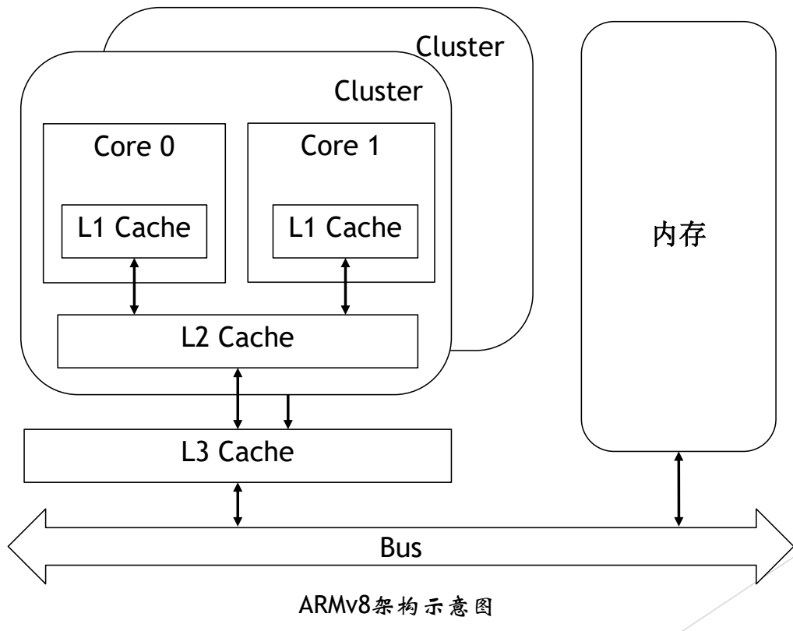
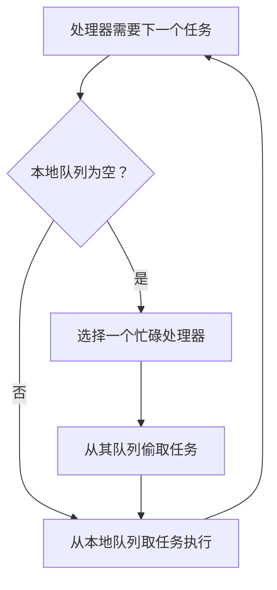
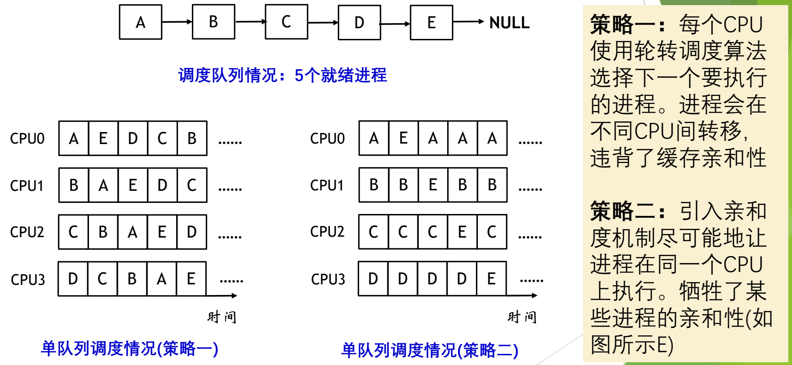
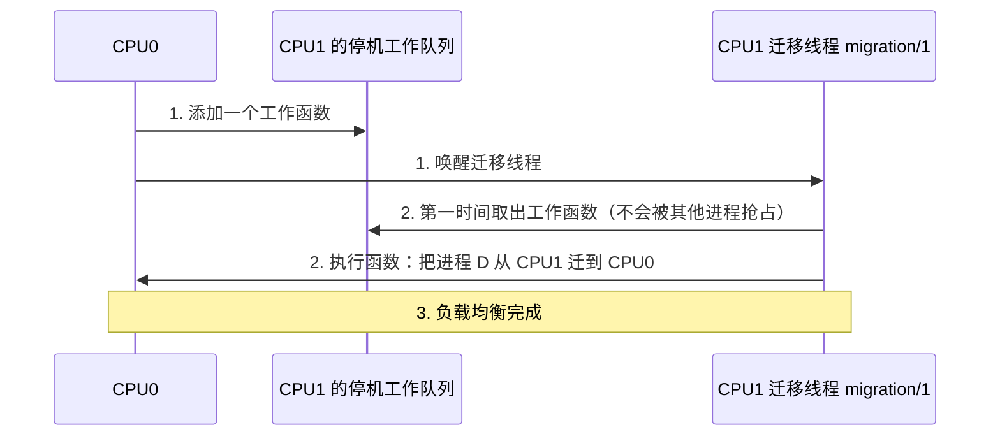

# 02 多核缓存问题与负载均衡

[本讲目录](../index.md) · [课程目录](../../index.md) · [上一节：01 多处理器调度的基本问题](01-multiprocessor-scheduling-basics.md) · [下一节：03 实时调度](03-real-time-scheduling-rm-edf.md)

> [!abstract] 本节要点
> - 多核下 L1/L2 缓存通常每核私有、L3 共享，缓存与主存的关系变了，于是出现四个问题：缓存一致性、缓存亲和性、核间数据共享、负载均衡。
> - 缓存一致性：P1、P2 各自缓存 $X=0$ 后各做 $X=X+1$，结果应为 2，却可能因缓存未同步而得到 1；硬件用 MESI 协议保证一致。
> - 缓存亲和性要求进程尽量留在同一核心上以复用缓存，负载均衡却要把任务迁走，两者天然矛盾（例：并行计算/图像渲染、CDN 缓存）。
> - 作业偷取（Work Stealing）：先执行本地队列，本地队列空时由空闲处理器主动从忙碌处理器的队列中“偷”任务；Go 的 GMP 调度器就是这样做的。
> - YARN 把任务放到存有所需数据的节点上（数据亲和），并由 ResourceManager 汇总资源、多队列分配；openEuler 用每 CPU 多队列，并通过迁移线程 migration/CPUID 做负载均衡。

## 多核缓存结构与四个问题

[多处理器调度的基本问题](01-multiprocessor-scheduling-basics.md)已经指出迁移会造成缓存失效。要看清代价从哪来，需要先看多核处理器的缓存结构。

图：ARMv8 多核示意，Core 0/Core 1 各有私有 L1 Cache，同一 Cluster 共享 L2 Cache，多个 Cluster 共享 L3 Cache，再经 Bus 连接内存；看缓存逐级共享的范围。

以 ARMv8 架构为例：每个核心（Core 0、Core 1……）有自己私有的 L1 Cache；若干核心组成一个 Cluster，共享该 Cluster 的 L2 Cache；各 Cluster 通过总线（Bus）共享 L3 Cache，再连到内存。数据从内存先进入缓存，处理器再从缓存中取用。

缓存和主存的这种关系带来四个问题：[^s1p82]

1. **缓存一致性问题**：同一个内存数据可能在多个核的私有缓存中各有一份副本。
2. **缓存亲和性问题**：进程在某个核上运行时，这个核的缓存对它“友好”；换一个核，缓存就对它不友好。
3. **核间数据共享**：多个核要共享同一份数据。
4. **负载均衡**：各核的工作量要大致均衡。

这些因素都是在前面单处理器调度算法的考虑之外新增的。

## 缓存一致性与 MESI

**缓存一致性**（cache coherence）指同一内存数据在多个缓存中的副本必须保持一致，否则各处理器会读到不同的值。[^s1p83]

> [!info] 可视化资源
> - [维基百科：MESI protocol](https://en.wikipedia.org/wiki/MESI_protocol)：看 M/E/S/I 四种状态定义与状态转换图，理解硬件如何避免 X 被两个核各加 1 却只得 1。

> [!example] 例：两个处理器同时给 X 加 1
> 设共享数据 $X$ 初值为 0，P1 和 P2 都读取并修改它。
>
> 1. P1 读 $X$，P1 的缓存中 $X=0$；P2 读 $X$，P2 的缓存中 $X=0$。
> 2. P1 执行 $X=X+1$，P1 的缓存中 $X=1$。
> 3. P2 执行 $X=X+1$，它用的是自己缓存中的旧值 0，P2 的缓存中也是 $X=1$。
> 4. 两次加法后正确结果应为 $X=2$，但由于两个缓存没有同步，最终写回内存的可能是 1。

解决办法是由硬件通过协议保证一致性，常用的是 **MESI 协议**。它根据缓存行中的数据是否被修改过、是否与内存中的数据一致等信息来维护各缓存的副本。[^s3b2]

> [!note] 补充解释
> MESI 是缓存行四种状态的首字母：**M**odified（已修改，只有本缓存有，与内存不一致）、**E**xclusive（独占，只有本缓存有，与内存一致）、**S**hared（共享，多个缓存都有，与内存一致）、**I**nvalid（无效）。一个核要写某行时，先让其他核中该行的副本变为 Invalid。上例中 P2 的旧副本 $X=0$ 会因此失效，P2 必须重新获得最新值 1 再加 1，结果就是 2。课程只要求知道问题和协议名称。

## 缓存亲和性与负载均衡的矛盾

**缓存亲和性**（cache affinity）指在多核处理器系统中，让特定进程或线程尽可能在同一个处理器核心上运行，以最大程度利用之前已经加载到该核心缓存中的数据，提高数据访问速度和系统整体性能。[^s1p84]

负载均衡可能会改变亲和性：为了让各核忙闲均匀而把任务迁到别的核，原来缓存里的数据就用不上了，会带来性能损失。两者总是矛盾的，下面两个例子分别来自计算任务和网络服务。[^s1p85]

**例 1：多核并行计算 / 图像渲染**

1. 把一部分数据对应的计算任务分配到某个核上。这部分数据被频繁访问，留在该核的缓存里，访问速度很快。
2. 但不同部分的计算量可能并不均匀，导致各核负载不同。
3. 于是把负载重的核上的部分计算任务转移到负载轻的核上，让大家同时计算，使整体计算时间最小化。
4. 代价是：被转移的任务在新核上会遇到额外的缓存不命中。

**例 2：CDN 缓存**

1. 按用户或地区，把常被访问的数据（如视频、商品详情）缓存到对应的 CDN 服务器上，加快用户访问。
2. 当某地服务器负载较大时，可能把该地区用户的请求路由到其他地区的服务器。
3. 代价是：其他地区的服务器上没有这些内容，增加了内容缓存不命中的开销。

两个例子结构相同：亲和带来命中率，均衡带来并行度，任何调度策略都要在两者之间折中。

> [!tip] 课堂强调
> 调度这部分讨论问题要把各种因素都考虑进去。要学的是一种思路：先把问题找出来，再去讨论它，而不是只给出一个答案就结束。[^s3b2]

## 作业偷取

**作业偷取**（Work Stealing）的核心思想是：让空闲的处理器从忙碌的处理器那里“偷取”任务来执行，使各处理器的负载相对均衡。[^s1p86] 它是每 CPU 队列结构下实现负载均衡的一种常见手段。

流程如下：

1. **初始分配**：任务按照一定策略分配到多个处理器各自的待执行队列（ready 队列）里。
2. **本地优先**：每个处理器优先执行本地队列里的任务，从而保持亲和性。
3. **空闲时偷取**：当某个处理器的本地待执行队列为空时，它去其他处理器的待执行队列里“偷取”任务来执行。

偷取是**空闲方主动去拿**，而不是忙碌方把任务推出去。[^s3b2]

> [!note] 补充解释
> 幻灯片在此留有“优点/缺点？”的设问，课堂没有展开。按本章的分析可以这样归纳：**优点**是只有空闲时才发生迁移，平时任务留在本地，兼顾了亲和性与负载均衡；均衡工作由闲着的处理器承担，忙碌处理器不必花时间判断该推走谁；也没有全局队列锁。**缺点**是被偷走的任务失去缓存亲和性；偷取时要访问别人的队列，仍需同步；选错“受害者”（例如偷到一个马上就会结束的任务）会白白付出开销。

## 应用实例：Go GMP 与 Hadoop YARN

调度思想不只存在于操作系统的进程调度中，在很多层次都有。下面两个实例都体现了“亲和性 + 偷取或多队列分配”。

> [!info] 可视化资源
> - [Go 运行时 HACKING 文档：Scheduler structures](https://go.dev/src/runtime/HACKING)：看 Scheduler structures 一节：G（goroutine）、M（OS 线程）、P（执行资源，数量为 GOMAXPROCS，类似每 CPU 状态）的分工。

**Go 语言 GMP 调度器**：GMP 调度器是 Go 运行时系统的核心部分，用来管理和调度 Goroutine（Go 的协程），类似于操作系统内核管理和调度进程/线程，也类似用户级线程由 run-time system 调度。[^s1p87] 其中 G 是 Goroutine，M 是内核线程，P 是逻辑处理器（调度上下文）。它的做法是：

- 尽量把 Goroutine 调度到之前访问过相同数据的同一处理器上执行；
- 尽量把 Goroutine 调度到之前执行它的同一个 P 所绑定的内核线程 M 上运行，以保持缓存亲和性；
- 每个 P 维护一个本地 Goroutine 队列；本地队列执行完后，尝试从其他 P 的本地队列中窃取 Goroutine 来执行，这正是作业偷取。

**Hadoop YARN**：YARN 是一种调度与资源管理框架，在分布式节点层面做调度。[^s1p88]

- **NodeManager** 管理本节点上的资源和容器，与 HDFS 等分布式文件系统协作，保证数据在多个节点之间的缓存一致性；并把需要处理相同数据的任务分配到存储有该数据的节点上，以提高缓存利用率（数据亲和）。
- **ResourceManager** 收集各节点 NodeManager 上报的资源使用情况，协调任务的资源需求，把任务分配到不同节点上：哪个节点空闲，就往哪里分配。
- YARN 支持**多队列调度**，不同队列可以设置不同的资源分配策略。

| 维度 | Go GMP | Hadoop YARN |
| --- | --- | --- |
| 调度层次 | 语言运行时，调度 Goroutine | 分布式集群，调度任务到节点 |
| 亲和的对象 | 处理器缓存（同一 P/M） | 数据所在节点（数据本地性） |
| 均衡手段 | 本地队列空时从其他 P 窃取 | ResourceManager 汇总资源，多队列分配 |

## openEuler 的单队列、多队列与迁移线程

> [!info] 依据讲义整理
> 本小节对应讲义中 openEuler 多核调度的几页，课堂未讲解。其中 ARMv8 多核示意图和“多核处理器系统面临的问题”两页与本章开头内容相同，不再重复。[^s1p98][^s1p99]

**单队列调度**：设有 5 个就绪进程 A、B、C、D、E 排在一个全局队列中，由 4 个 CPU 共同调度。[^s1p100]

图：5 个就绪进程 A–E 组成单一队列，左侧策略一中进程在 CPU0–CPU3 间轮转迁移，右侧策略二借助亲和度让 A、B、C、D 基本固定在各自 CPU，只有 E 在多个 CPU 间移动。

- **策略一**：每个 CPU 使用轮转调度算法从公共队列中选择下一个要执行的进程。从图中可见，进程会在不同 CPU 之间轮流转移（如 A 依次出现在 CPU0、CPU1、CPU2……），违背了缓存亲和性。
- **策略二**：引入亲和度机制，尽可能让进程在同一个 CPU 上执行：A 基本留在 CPU0，B 留在 CPU1，以此类推。5 个进程分到 4 个 CPU 上总有一个要“流动”，图中由 E 在各 CPU 之间轮转填补空位。即牺牲了某些进程（如 E）的亲和性，换取其余进程的亲和性。

**多队列调度**：openEuler 使用多队列调度策略，每个 CPU 维护自己的队列，例如队列 Q0 由 CPU0 维护，Q1 由 CPU1 维护。[^s1p101]

1. 调度之初：Q0 中有 A、C，Q1 中有 B、D，各 CPU 在本地队列中采用轮转调度。CPU0 上 A、C 交替运行，CPU1 上 B、D 交替运行。
2. 一段时间后，假设 A、C 两个进程都结束了，Q0 为空，Q1 中仍有 B、D：CPU0 空闲而 CPU1 上有两个进程，负载失衡。

这正是[多处理器调度的基本问题](01-multiprocessor-scheduling-basics.md)中每 CPU 队列“忙闲不均”的具体表现。

**迁移线程**：解决多 CPU 负载不均衡最直接的方法是让就绪进程跨 CPU 迁移。上例中把进程 D 迁移到 CPU0 上运行，CPU0 和 CPU1 就实现了负载均衡。在 openEuler 中，每个处理器都有一个**迁移线程**（名为 `migration/CPUID`），每个迁移线程有一个由函数组成的**停机工作队列**（stopper work queue）。[^s1p102] 迁移过程如下：

1. CPU0 向 CPU1 的停机工作队列中添加一个工作函数，并唤醒 CPU1 上的迁移线程。
2. 该迁移线程不会被其他进程抢占，因此能第一时间从停机工作队列中取出函数执行，把进程从 CPU1 迁移到 CPU0。
3. 此时实现负载均衡。

注意这里由空闲的 CPU0 发起迁移，思路与作业偷取一致。

> [!question]- 自测：两线程程序在双核机器上反复对同一全局计数器做 `count++`（未加锁），运行结束后计数常小于预期。只靠 MESI 协议能否解决这个问题？
> 不能完全解决。MESI 保证的是每个缓存行的副本最终一致，不会出现“各写各的副本、永远不同步”。但 `count++` 是“读—加—写”三步，两个核可能都读到同一个旧值再各自写回，这是并发访问的原子性问题，仍需要锁或原子指令来保证同步。

> [!question]- 自测：在作业偷取中，若每个处理器总是从别人队列里偷“刚加入、尚未运行过”的任务，而不是偷“已运行过一段时间”的任务，对缓存亲和性有什么影响？
> 影响更小。没运行过的任务在原处理器的缓存中还没有积累数据，偷到哪里都要从头装入缓存，迁移几乎不损失亲和性；已运行过的任务在原处理器缓存中有热数据，被偷走会造成额外的缓存不命中。

> [!info]- 来源
> - slides04.pdf：PDF p.81–88, 98–102
> - L08.docx：DOCX body 1–48

[^s1p82]: slides04.pdf-PDF p.82
[^s1p83]: slides04.pdf-PDF p.83
[^s3b2]: L08.docx-DOCX body 29-48
[^s1p84]: slides04.pdf-PDF p.84
[^s1p85]: slides04.pdf-PDF p.85
[^s1p86]: slides04.pdf-PDF p.86
[^s1p87]: slides04.pdf-PDF p.87
[^s1p88]: slides04.pdf-PDF p.88
[^s1p98]: slides04.pdf-PDF p.98
[^s1p99]: slides04.pdf-PDF p.99
[^s1p100]: slides04.pdf-PDF p.100
[^s1p101]: slides04.pdf-PDF p.101
[^s1p102]: slides04.pdf-PDF p.102

[本讲目录](../index.md) · [课程目录](../../index.md) · [上一节：01 多处理器调度的基本问题](01-multiprocessor-scheduling-basics.md) · [下一节：03 实时调度](03-real-time-scheduling-rm-edf.md)
