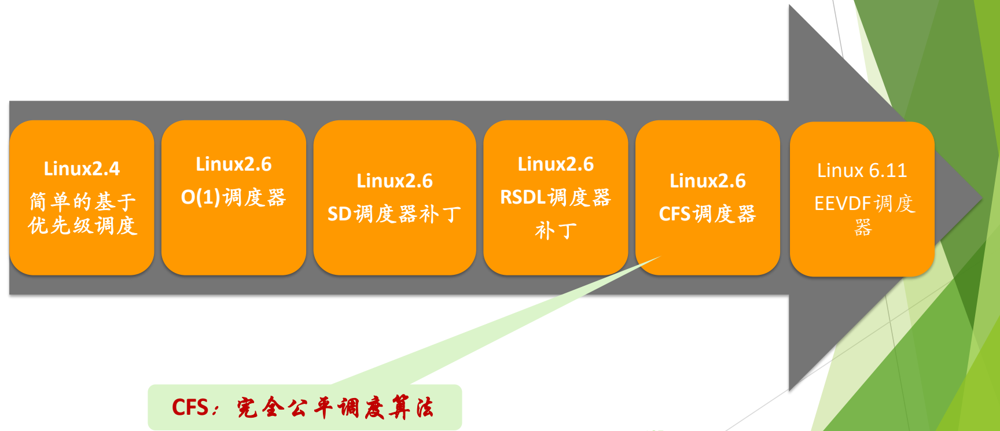
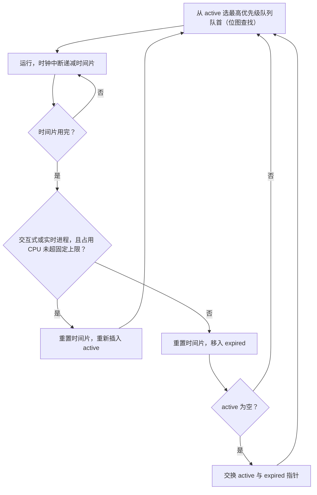
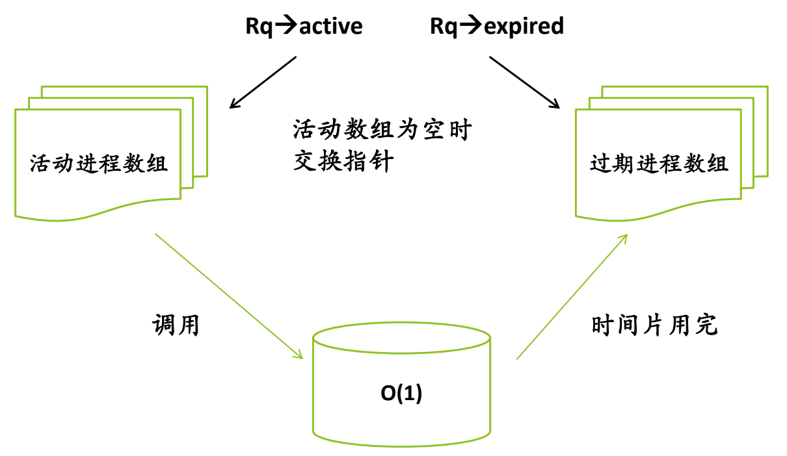

# 04 Linux 2.4 与 O(1) 调度器

[本讲目录](../index.md) · [课程目录](../../index.md) · [上一节：03 实时调度](03-real-time-scheduling-rm-edf.md) · [下一节：05 楼梯调度 SD 与 RSDL](05-staircase-sd-and-rsdl.md)

> [!abstract] 本节要点
> - Linux 进程分为**实时进程**（FIFO、RR，优先级总高于普通进程）和**普通进程**（交互式、批处理）；普通进程调度的难点是照顾交互式进程。
> - 调度器演化：2.4 → 2.6 的 O(1) → SD 补丁 → RSDL 补丁 → CFS → EEVDF；主线是从“猜谁是交互式进程”转向“完全公平”。
> - 2.4：单一 runqueue，每次遍历全部进程比较优先级；优先级由 counter（剩余时间片）与 nice 决定；所有可运行进程的时间片都用完后统一重算，睡眠进程未用完的 counter 被累加，从而获得更高优先级。
> - 2.4 的缺点：选择与重算开销随进程数增长（可扩展性差）、高负载性能低、以睡眠时长界定交互式不准确、内核非抢占对实时支持不足。
> - O(1)：每个 CPU 两个按优先级组织的数组 active/expired，配合位图在常数时间内选出最高优先级进程；时间片用完的进程移入 expired，active 为空时交换指针；但基于平均睡眠时间的经验公式难懂、区分交互式仍常失效。

## Linux 的进程分类

调度算法先要回答“为谁优化”。Linux 把进程分成两类，分别走不同的调度路线。[^s1p104]

- **实时进程**：对调度延迟要求最高，要求立即响应并执行；调度策略是 FIFO 和 Round Robin（RR）。
- **普通进程**：
  - **交互式进程**：间或处于睡眠态，对响应速度要求比较高；
  - **批处理进程**：在后台执行，能够忍受响应延迟。
  - 普通进程的调度策略是 CFS（见 [CFS 完全公平调度](06-cfs-vruntime-and-red-black-tree.md)）。

批处理进程不在乎延迟，因此普通进程调度真正的关注点是交互式进程。交互式进程有两个特征：**行为**上它在睡眠态与就绪态之间反复切换（典型的 I/O 型进程）；**目标**上它要求对用户的操作尽快给出回应。后面各代调度器的差别，主要就在于如何对待这类进程。[^s3b3]

> [!warning] 易错点
> Linux 的“实时进程”和 Windows 优先级 16–31 的“实时”线程一样，不是[实时调度](03-real-time-scheduling-rm-edf.md)意义上“必须在截止时间前完成”的实时任务。它只表示优先级比普通进程高、就绪后要尽快运行（多为服务用户的系统任务），因此不与普通进程共用算法，直接按 FIFO 或 RR 调度。Windows 的优先级分类见 L07「07 Windows 线程调度」。[^s3b3]

### openEuler 中的调度

openEuler 的调度概念与前面所学一致：[^s1p95]

1. **CPU 调度**（进程调度）是操作系统在必要时中断当前进程、从就绪进程中选出一个占用 CPU 的过程；完成选择的程序叫**调度程序**（Scheduler），它依据**调度策略**（Scheduling Policy）决定何时、以何种方式选出新进程。有多个 CPU 或多核时，调度程序还要考虑核间的数据共享与数据同步。
2. 常见算法有 FIFO/FCFS、SJF、RR 和优先级调度；openEuler 联合使用 FIFO、RR 和优先级调度来调度**实时进程**。[^s1p96]
3. openEuler 中大部分进程是普通进程，更需要公平性，核心策略“标准轮流分时调度策略”采用 **CFS**（Completely Fair Scheduler）：它使用时间片和优先级的概念，并引入虚拟运行时间，按系统负载和进程优先级分配 CPU 使用比例，保证普通进程的相对公平。[^s1p97]

## 调度器的演化脉络

前面只列过名字的公平分享调度、保证调度等算法都指向同一件事：**公平**——CPU 是所有进程共享的，整体上每个进程对 CPU 的使用应当公平。[^s3b4] Linux 调度器的历史，就是在“优待交互式进程”和“公平、简单、低开销”之间不断调整的过程。

图：Linux 调度器演化顺序：2.4 简单的基于优先级调度 → 2.6 O(1) → SD 补丁 → RSDL 补丁 → CFS → 6.11 EEVDF；CFS 即完全公平调度算法。

> [!note] 补充解释
> 图中“Linux 6.11 EEVDF”是讲义的标注；主线内核中 EEVDF 实际于 Linux 6.6 合入，版本更正见 [CFS 情景分析与 EEVDF](07-cfs-scenarios-and-eevdf.md)。另外，SD 与 RSDL 是 Con Kolivas 维护的树外补丁，从未进入主线；主线在 Linux 2.6.23 由 O(1) 直接换成 CFS。图中把它们画成“Linux 2.6 补丁”，表示的是思想上的演化顺序。
演化的几个关键转折：[^s3b3]

1. **2.4** 基于优先级，统治时间很长，但优先级计算越来越难解读。
2. **O(1)** 着眼于“选人要快”：调度算法本身也有开销，如果选一个进程要花很久，还不如直接选第一个。O(1) 选得快、开销小，但考虑的因素太简单，很快被替代。
3. **SD、RSDL** 是此后的两个补丁，放弃动态优先级，转向完全公平（见 [楼梯调度 SD 与 RSDL](05-staircase-sd-and-rsdl.md)）。
4. **CFS** 在此基础上长期落地；最新内核（新版 Ubuntu 也已跟进）切换到 **EEVDF**，但其核心思想仍是 CFS，相当于为 CFS 未考虑到的问题打补丁（见 [CFS 情景分析与 EEVDF](07-cfs-scenarios-and-eevdf.md)）。

## Linux 2.4 调度器

**Linux 2.4 调度器**的结构可以概括为 RunQueue + 时间片 + 优先级：[^s1p106]

1. **选择**：对 runqueue 中所有进程的优先级依次比较，选优先级最高者作为下一个被调度的进程。
2. **时间片**：进程创建时被赋予一个时间片；每次时钟中断递减当前运行进程的时间片，时间片就是一个定时器，减到 0 就必须切换下去，等待重新赋予时间片才能再运行。
3. **统一重算**：只有当所有 RUNNING 进程的时间片都用完之后，才对所有进程重新分配时间片。这与轮转（RR）“转完一圈再来一圈”的思想一致，保证每个进程都有机会执行。

### counter 与 nice

普通进程的优先级由进程描述符中的 **counter** 字段与 **nice** 设定的静态优先级共同决定。[^s1p107]

- **counter** 就是时间片（剩余的时钟滴答数），每个进程的值可能不同，并随每轮重算而变化；counter 越大，优先级越高。
- **nice** 沿用自最初的 UNIX，表示进程的静态“负向”优先级，取值范围为 $-20 \sim 19$，$-20$ 优先级最高：nice 值越小，优先级越高。

> [!note] 补充解释
> 课堂口述的 nice 范围是“$-19$ 到 $20$”，这里按讲义改为 Linux 实际使用的 $-20 \sim 19$。[^s1p107] 讲义把优先级简写为“counter + nice”，意思是两者共同决定优先级；由于 nice 越小优先级越高，2.4 内核源码中普通进程的权值（`goodness()`）实际约为 $\text{counter} + 20 - \text{nice}$，即 counter 越大、nice 越小，越优先。

**对睡眠进程的优待**：重算时不仅 RUNNING 进程，处于睡眠状态的进程也要重算 counter。睡眠进程的 counter 本来没有用完，重算时会加上这些未用完的部分，于是优先级提高——系统试图用这种方式提高交互式进程的响应速度。[^s1p107]

实时进程的规则不同：实时进程的 counter 用完后立刻重置并放回就绪队列；非实时进程则要等 runqueue 中所有进程的时间片都用完，才统一重新计算 counter。[^s1p107]

> [!note] 补充解释
> 2.4 源码中的重算公式是 `p->counter = (p->counter >> 1) + NICE_TO_TICKS(p->nice);`，即“剩余 counter 的一半 + 由 nice 决定的基准时间片”。因此长期睡眠的进程 counter 会逐轮累积，但上限不超过基准值的 2 倍，不会无限增长。

> [!example] 例：两个进程经过一轮重算
> 设 A、B 的 nice 相同，基准时间片都对应 counter $=6$。
>
> 1. A 是计算型进程，一直运行到 counter $=0$；B 运行了 2 个滴答后进入睡眠，counter 停在 $4$。
> 2. 所有可运行进程的时间片用完，触发重算：A 的新 counter $=0/2+6=6$，B 的新 counter $=4/2+6=8$。
> 3. B 的 counter 更大，优先级更高，醒来后更容易被先选中——这就是 2.4 对睡眠进程的“优待”。

### 2.4 的缺点

讲义列出四个缺点，并指出 2.4 内核是**非抢占**的：[^s1p108]

1. **可扩展性不好**：每次选择都要遍历 runqueue，每轮重算要遍历所有进程，队列里有 100 个进程和 1000 个进程时开销不同，算法开销与进程数量相关。[^s3b4]
2. **高负载系统上调度性能低**：这一结论来自 benchmark 测试数据。
3. **交互式进程的优化不完善**：用睡眠时间代表“交互式”并不合理，睡眠时间长的进程不一定是交互式进程。
4. **对实时进程支持不够**：内核非抢占，高优先级的实时进程到来后也不能立即抢占正在运行的进程。

为解决这些问题，Ingo Molnar 开发了新的 O(1) 调度器。

## O(1) 调度器

**O(1) 调度器**在两个方面修改了 2.4 调度器：进程优先级的计算方法和 pick next 算法。[^s1p109]

### 优先级计算

O(1) 继续试图识别交互式进程，但换成了基于**平均睡眠时间**的经验公式：[^s1p110]

- **普通进程**：平均睡眠时间用来判断进程是否是交互式进程；平均睡眠时间越长，其 bonus 越大，优先级越高。
- **实时进程**：优先级不会动态修改，而且总比普通进程高。

$$
\text{动态优先级} = \max\bigl(100,\ \min(\text{静态优先级} - \text{bonus} + 5,\ 139)\bigr)
$$

$$
\text{动态优先级} \le \frac{3 \times \text{静态优先级}}{4} + 28
$$

这里优先级是“数值越小越优先”的优先数：普通进程的动态优先级被夹在 $[100, 139]$ 内，bonus 越大，动态优先级数值越小、越优先。这些系数是经验值，难以从原理上解读。[^s3b4]

> [!note] 补充解释
> 在 2.6 内核中，实时进程优先级为 $0 \sim 99$，普通进程为 $100 \sim 139$，静态优先级 $=120+\text{nice}$；bonus 由平均睡眠时间换算，范围 $0 \sim 10$。第二个不等式对应源码中的交互式判定（`TASK_INTERACTIVE`）：动态优先级满足它的进程被视为交互式进程。

> [!example] 例：nice 为 0 的两个进程
> 静态优先级 $=120$，交互式门槛 $=\frac{3\times120}{4}+28=118$。
>
> 1. 常睡眠的进程 bonus $=10$：动态优先级 $=\max(100,\min(120-10+5,139))=115 \le 118$，被判为交互式。
> 2. 计算型进程 bonus $=0$：动态优先级 $=\max(100,\min(125,139))=125 > 118$，被判为非交互式。

### pick next 与 active/expired 数组

O(1) 为**每个 CPU** 维护两个进程队列数组，即 **active** 和 **expired**。数组的每个元素对应一个优先级，保存该优先级就绪进程队列的指针。[^s1p111] 机制如下：

1. **选择**：直接从 active 数组中取当前最高优先级队列的第一个进程。用一个位图（mask）记录哪些优先级队列非空，就能在常数时间内找到有进程的最高优先级队列，开销与进程数无关，这就是“O(1)”的含义。[^s3b4]
2. **时间片用完**：调度器判断进程类型。交互式进程或实时进程重置时间片后重新插入 active 数组；其他进程从 active 移到 expired 数组。
3. **防止长期占用 active**：进程占用 CPU 的时间超过一个固定值后，即使是实时进程或交互式进程，也必须移到 expired 数组。这保证 active 数组在有限时间内清空。
4. **交换**：当 active 中所有进程都移到了 expired 后，交换 active 与 expired 两个数组的指针，新一轮开始；进程被移入 expired 时调度器已重置其时间片，因此交换后无需再统一重算。

图：O(1) 调度器从活动进程数组调用进程，时间片用完的进程进入过期进程数组；活动数组为空时交换 Rq→active 与 Rq→expired 两个指针。

### O(1) 为什么“昙花一现”

O(1) 区分交互式进程与批处理进程的算法比 2.4 有较大改进，但在很多情况下仍会失效：一些典型的测试程序总能使其性能下降，导致交互式进程反应缓慢。同时，动态优先级依赖平均睡眠时间和难以理解的经验公式，代码很难阅读和维护。[^s1p113] 于是 Con Kolivas 开发了楼梯调度算法 SD 及其改进版 RSDL。[^s3b5]

> [!warning] 易错点
> “O(1)”指的是**选择下一个进程**的时间复杂度为常数，并不意味着它的调度效果更好。O(1) 解决了 2.4 的可扩展性问题，但没有解决“如何准确识别交互式进程”这一根本问题。

> [!question]- 自测：2.4 调度器中，runqueue 有 1000 个可运行进程时，为什么调度开销明显大于 100 个进程？O(1) 是怎样消除这种差异的？
> 2.4 每次选进程都要遍历 runqueue 逐个比较优先级，所有时间片用完后还要为所有进程（包括睡眠进程）重算 counter，两者都是 $O(n)$。O(1) 按优先级把就绪进程分到数组的各个队列中，用位图常数时间找到最高优先级的非空队列并取队首；时间片在进程移入 expired 时就已重置，active 空时只交换两个指针，无需遍历重算。

> [!question]- 自测：一个 nice 为 0 的普通进程在 O(1) 中长期是交互式进程，它能否永远留在 active 数组里？
> 不能。交互式进程时间片用完后通常会被重新插入 active，但当它占用 CPU 的时间超过固定上限后，不论类型都必须移入 expired。这保证 active 在有限时间内清空，expired 中的进程不会饥饿。

> [!info]- 来源
> - slides04.pdf：PDF p.94–97, 103–113
> - L08.docx：DOCX body 49–114

[^s1p104]: slides04.pdf-PDF p.104
[^s3b3]: L08.docx-DOCX body 49-68
[^s1p95]: slides04.pdf-PDF p.95
[^s1p96]: slides04.pdf-PDF p.96
[^s1p97]: slides04.pdf-PDF p.97
[^s3b4]: L08.docx-DOCX body 69-97
[^s1p106]: slides04.pdf-PDF p.106
[^s1p107]: slides04.pdf-PDF p.107
[^s1p108]: slides04.pdf-PDF p.108
[^s1p109]: slides04.pdf-PDF p.109
[^s1p110]: slides04.pdf-PDF p.110
[^s1p111]: slides04.pdf-PDF p.111
[^s1p113]: slides04.pdf-PDF p.113
[^s3b5]: L08.docx-DOCX body 98-114

[本讲目录](../index.md) · [课程目录](../../index.md) · [上一节：03 实时调度](03-real-time-scheduling-rm-edf.md) · [下一节：05 楼梯调度 SD 与 RSDL](05-staircase-sd-and-rsdl.md)
