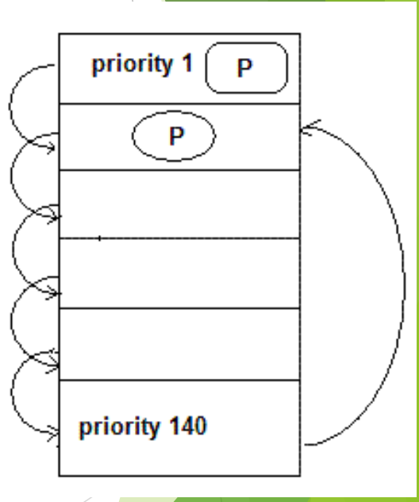
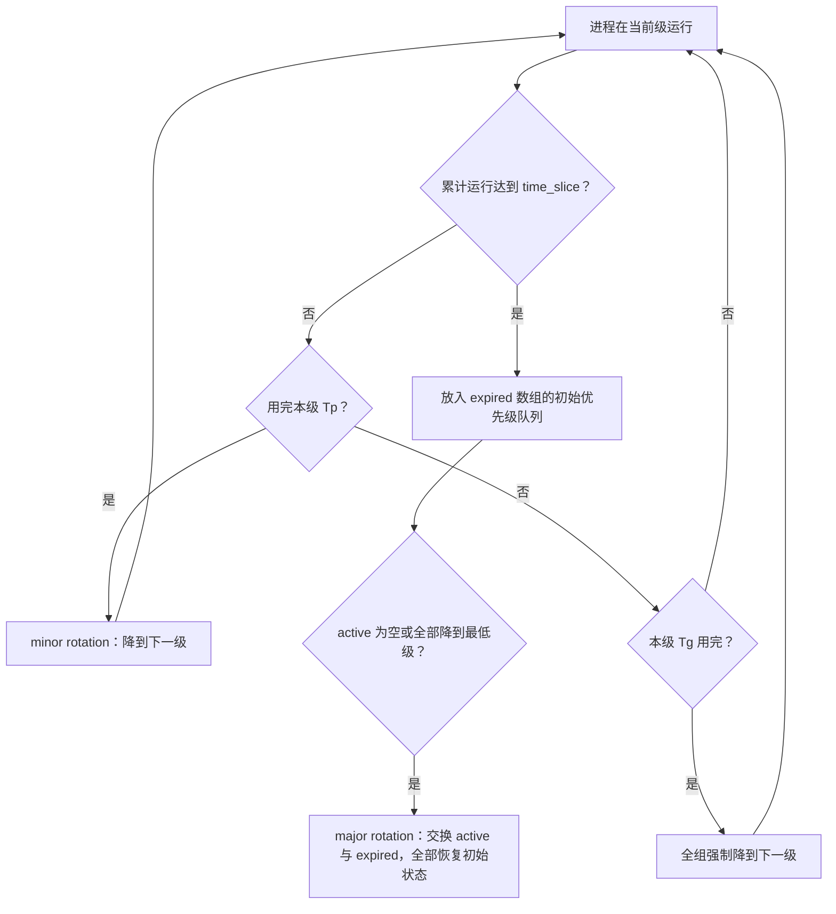
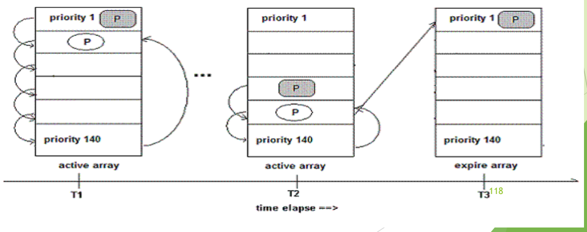

# 05 楼梯调度 SD 与 RSDL

[本讲目录](../index.md) · [课程目录](../../index.md) · [上一节：04 Linux 2.4 与 O(1) 调度器](04-linux-scheduler-evolution-2-4-and-o1.md) · [下一节：06 CFS 完全公平调度](06-cfs-vruntime-and-red-black-tree.md)

> [!abstract] 本节要点
> - **SD（楼梯调度）**放弃动态优先级：进程用完时间片就降到 active 数组中低一级的队列（进程本身的优先级不变），降到最低一级后再用完时间片，就回到初始优先级的下一级。
> - SD 能避免饥饿：高优先级进程终会降到与低优先级进程同一层竞争；交互式进程睡眠期间同级进程逐级下沉，醒来时它仍在高处，相当于获得补偿。
> - SD 与 MLFQ 的区别：MLFQ 新进程都进第一级、降到底不再上升；SD 按进程原优先级入队，降到底后回升。
> - **RSDL** 重新引入 expired 数组，为每个优先级设**组时间配额** $T_g$、为每个进程设**进程时间配额** $T_p$：用完 $T_p$ 降一级（minor rotation），本级 $T_g$ 用完则全组强制降一级，使低优先级进程的等待时间可预计。
> - RSDL 中时间片 $\ne T_p$（一般 $T_p <$ time_slice）：时间片用完进入 expired 数组的初始优先级队列；active 为空或所有进程降到最低级时触发 major rotation，交换两个数组。

## SD 楼梯调度（Staircase Scheduler）

O(1) 试图靠经验公式识别交互式进程却屡屡失效。SD 换了思路：不再动态计算优先级，而是让所有进程沿着优先级“楼梯”轮流下行，用结构本身保证公平并照顾交互式进程。[^s1p114]

**楼梯调度**（staircase scheduler，SD）抛弃动态优先级的概念，采用完全公平的思路。与 O(1) 一样，它为每个优先级维护一个进程列表，组织在 active 数组中，选下一个进程时直接从 active 数组读取。[^s1p114] 规则如下：

1. **按原优先级入队**：进程从自己的优先级所在的台阶开始。
2. **用完时间片就下一级台阶**：进程用完时间片后并不移到 expired 数组，而是加入 active 数组中低一优先级的列表；再次用完，就再放入更低一级。降级只改变它所在的队列，**任务本身的优先级并没有改变**。
3. **到底后回升**：任务到达最低一级后，如果时间片再次用完，会回到初始优先级的下一级任务队列。讲义的说法是：任务从第 $N$ 级台阶开始下楼梯并到达底部后，将回到第 $N+1$ 级台阶，同时被赋予 $N+1$ 倍的时间片。[^s1p115]
4. **实时进程不参与楼梯**：实时进程仍然采用原来的 FIFO 或 RR 调度策略。

图：楼梯调度中进程 P 从 priority 1 逐级下到 priority 140，到底后回到初始优先级的下一级；看左侧逐级下降的箭头与右侧返回的长箭头。

### 为什么能避免饥饿、照顾交互式进程

- **避免饥饿**：高优先级进程每用完一次时间片就下降一级，最终会降到和低优先级进程同一层竞争 CPU，低优先级进程因此一定能获得执行机会。[^s1p115]
- **补偿交互式进程**：交互式进程进入睡眠后，与它同等优先级的其他进程一步一步下楼梯，进入低优先级队列；当它被唤醒时还留在高处的台阶，因而更快被选中，响应时间缩短。这相当于对“没用完时间片就去睡眠”的补偿，而且无需任何睡眠时间统计或经验公式。[^s3b5]

### SD 与多级反馈队列的比较

SD 的“用完时间片降一级”与多级反馈队列（MLFQ，见 L07「05 多级队列与多级反馈队列」）很像，区别在入口和出口：[^s3b5]

| 对比项 | 多级反馈队列 MLFQ | SD 楼梯调度 |
| --- | --- | --- |
| 新进程进入哪一级 | 都进入第一级（最高级） | 按进程原有的优先级进入对应级 |
| 用完时间片 | 降一级 | 降一级（进程优先级本身不变） |
| 降到最低一级后 | 停留在最底层不动 | 再用完时间片则回到初始优先级的下一级，并获得更多时间片 |
| 睡眠进程醒来 | 视具体规则而定 | 仍在原来的级别，同级进程已下沉，相当于补偿 |

> [!warning] 易错点
> SD 中进程“降级”降的是它所在的**队列层级**，不是它的**优先级**。正因为优先级固定不变，SD 才能在到底后让进程回到“初始优先级的下一级”——它必须记得自己的初始优先级。

## RSDL（The Rotating Staircase Deadline Scheduler）

SD 有一个问题：低优先级进程必须等所有高优先级进程（在楼梯上）执行完才能获得 CPU，高优先级层进程越多，它要等得越久，**等待时间无法确定**。RSDL 是 Con Kolivas 对 SD 的改进，核心思想仍是“完全公平”，没有复杂的动态优先级调整（一计算优先级就要花时间），而是用配额给每一层的运行时间设上限。[^s1p116] [^s1p117]

RSDL 涉及三个时间量：[^s1p116]

- **组时间配额** $T_g$：每个优先级分配一个组时间配额，无论该级有多少进程，这一级总共能运行的时间是固定的。
- **进程时间配额** $T_p$：同一优先级的每个进程拥有同样的时间配额。
- **时间片** time_slice：沿用原来的概念，每个进程有一个时间片；一般有 $T_p <$ time_slice。

RSDL 重新引入了 O(1) 的 expired 数组，运行规则如下：[^s1p117] [^s1p118]

1. **minor rotation**：进程用完自己在本级的 $T_p$ 后，下降到下一优先级进程组（与 SD 的降级相同），在新的一级再获得 $T_p$。
2. **组配额强制降级**：当高优先级进程组用完了它们的 $T_g$ 时，无论组中是否还有进程的 $T_p$ 尚未用完，该组所有进程都被强制降低到下一优先级进程组。
3. **时间片用完进入 expired**：进程在各级累计使用的配额达到它的 time_slice 时，被放入 **expired 数组中它初始的优先级队列**。
4. **major rotation**：当 active 数组为空，或所有进程都降低到最低优先级时触发 major rotation：交换 active 数组和 expired 数组，所有进程恢复到初始状态，重新开始 minor rotation 过程。

图：RSDL 中进程在 active array 内逐级下降（T1、T2），用完时间片后进入 expire array 的初始优先级队列（T3）；看三个时刻的数组与箭头。

因此低优先级任务可以在“可以预计的未来”得到调度。[^s1p117] 原因在于每一级每轮最多运行 $T_g$：一个低优先级进程之上有 $k$ 个非空优先级时，它的等待时间不超过约 $k T_g$。RSDL 的设计体现了多个指标的折中：优先级高的先运行、不饥饿、等待时间可预计，同时不付出动态计算优先级的开销。[^s3b5]

> [!example] 例：组时间配额如何限制高优先级层（据课程内容构造）
> 设第 1 级有 A、B、C 三个进程，$T_p=2$ ms，第 1 级的 $T_g=4$ ms；第 2 级有进程 D。
>
> 1. A 运行 2 ms，用完 $T_p$，minor rotation 降到第 2 级。
> 2. B 运行 2 ms，用完 $T_p$；此时第 1 级已累计运行 4 ms，$T_g$ 用完。
> 3. C 虽然还一次都没运行，也与 B 一起被强制降到第 2 级。
> 4. 于是 D 最多只需等第 1 级的 4 ms，就能与 A、B、C 在第 2 级竞争。若在 SD 中，第 1 级每增加一个进程，D 的等待时间就多一个时间片，无法预计。

> [!warning] 易错点
> $T_p$ 不是时间片。用完 $T_p$ 只是**降一级**（仍在 active 数组中）；用完时间片才**离开 active**，进入 expired 数组，并且放回的是它**初始优先级**的队列，等 major rotation 后从原来的台阶重新开始。

> [!question]- 自测：SD 中某交互式进程 X 与计算型进程 Y 初始优先级相同。X 运行一会儿就睡眠，Y 持续运行并连续用完三次时间片。X 醒来时谁更容易被选中？为什么 SD 不需要统计睡眠时间就能做到这一点？
> X 更容易被选中。Y 每用完一次时间片就下一级台阶，已降了三级；X 睡眠期间没有用完时间片，仍留在原来的高层，醒来后处于比 Y 更高的队列。优待来自楼梯结构本身——只有消耗了时间片的进程才会下沉——因此无需像 2.4、O(1) 那样记录睡眠时长或使用经验公式。

> [!question]- 自测：RSDL 中，一个进程用完了在本级的 $T_p$，另一个进程用完了它的 time_slice，二者分别去哪里？
> 前者执行 minor rotation，降到 active 数组中的下一优先级组，并在那一级获得新的 $T_p$；后者离开 active，放入 expired 数组中它**初始**优先级的队列，等到 active 为空或所有进程降到最低级触发 major rotation、交换两个数组后，才从初始优先级重新开始。

> [!info]- 来源
> - slides04.pdf：PDF p.114–118
> - L08.docx：DOCX body 98–114

[^s1p114]: slides04.pdf-PDF p.114
[^s1p115]: slides04.pdf-PDF p.115
[^s3b5]: L08.docx-DOCX body 98-114
[^s1p116]: slides04.pdf-PDF p.116
[^s1p117]: slides04.pdf-PDF p.117
[^s1p118]: slides04.pdf-PDF p.118

[本讲目录](../index.md) · [课程目录](../../index.md) · [上一节：04 Linux 2.4 与 O(1) 调度器](04-linux-scheduler-evolution-2-4-and-o1.md) · [下一节：06 CFS 完全公平调度](06-cfs-vruntime-and-red-black-tree.md)
