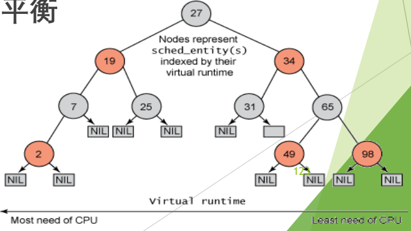
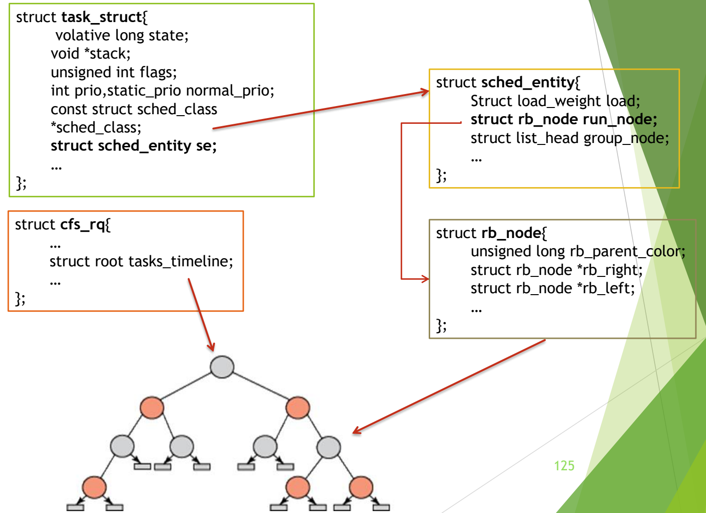

# 06 CFS 完全公平调度

[本讲目录](../index.md) · [课程目录](../../index.md) · [上一节：05 楼梯调度 SD 与 RSDL](05-staircase-sd-and-rsdl.md) · [下一节：07 CFS 情景分析与 EEVDF](07-cfs-scenarios-and-eevdf.md)

> [!abstract] 本节要点
> - CFS 吸收 SD/RSDL 的完全公平思想，不再跟踪睡眠时间、不再区分交互式进程，只按权重比例分配 CPU。
> - 公式 1：分配给进程的运行时间 $=$ 调度周期 $\times$ 进程权重 $/$ 所有进程权重之和。
> - 公式 2：$\text{vruntime} = \text{实际运行时间} \times \text{NICE\_0\_LOAD} / \text{进程权重}$；代入公式 1 后每个进程一个周期内的 vruntime 增量都是 $\text{调度周期} \times \text{NICE\_0\_LOAD} / \text{总权重}$，即“从 vruntime 角度大家分到的时间一样”；NICE_0_LOAD 是 nice 0 的权重，Linux 中为 1024。
> - 调度器每次选 vruntime 最小的进程：以 vruntime 为键的红黑树中取最左结点运行并移出，切换下来后按新 vruntime 重新插入。
> - 框架之外还有细节要定：新进程 vruntime 初值、休眠进程 vruntime、唤醒是否立即抢占、跨 CPU 迁移时 vruntime 如何处理。

## CFS 的基本思想

2.4 和 O(1) 总想考虑进程的睡眠时间、区分交互式与非交互式进程以优待 I/O 型进程，结果公式越来越复杂、效果仍不令人满意。**CFS**（完全公平调度，Completely Fair Scheduler）放弃这种努力，改为完全公平：每个进程公平地得到 CPU 时间。[^s3b5]

> [!info] 可视化资源
> - [OSTEP 第 9 章 9.7 节 Linux CFS（PDF）](https://pages.cs.wisc.edu/~remzi/OSTEP/cpu-sched-lottery.pdf)：看图 9.4 CFS 简单示例与图 9.5 CFS 红黑树，直观理解按 vruntime 选择进程。

CFS 从 RSDL/SD 中吸取了完全公平的思想，不再跟踪进程的睡眠时间，也不再企图区分交互式进程。[^s1p119] 它的核心是三句话：

1. 每个进程有一个**虚拟运行时间**（vruntime），表示该进程“运行了多长时间”；
2. 调度器总是选择虚拟运行时间最小的进程运行；
3. 虚拟运行时间与进程实际运行时间成正比，与进程优先级（权重）成反比。

CFS 以 vruntime 为键值构造红黑树，实现快速的更新与删除。本章讲按权重分配、vruntime 与数据结构；具体情景分析见 [CFS 情景分析与 EEVDF](07-cfs-scenarios-and-eevdf.md)。[^s1p120]

### 把 vruntime 理解为“进度”

vruntime 不是真实运行时间，而是**进度**：每个进程在一个调度周期里应得的份额不同，vruntime 衡量的是它完成了自己份额的百分之几。[^s3b6]

例如 A 在本周期应运行 10 ms，B 应运行 20 ms，二者的“100%”长度不同。A 运行 2 ms，进度是 20%；B 要运行 4 ms 才是 20%。若你的进度是 20%、他的是 30%，说明你落后了，就该先让你上 CPU。CFS 每次选 vruntime 最小者，就是让进度最落后的进程先跑，于是所有进程的进度宏观上同步推进。

## 按权重分配与 vruntime

**核心思想**：根据进程的优先级按比例分配运行时间。[^s1p121]

> [!info] 可视化资源
> - [Linux 内核文档：CFS Scheduler](https://docs.kernel.org/scheduler/sched-design-CFS.html)：官方说明 CFS 模拟“理想多任务 CPU”、按 vruntime 排序的红黑树取最左结点，以及 sched_class 调度类模块化。

$$
\text{分配给进程的运行时间} = \text{调度周期} \times \frac{\text{进程权重}}{\text{所有进程权重之和}} \qquad \text{（公式 1）}
$$

其中**调度周期**是把所有处于 TASK_RUNNING 态的进程都调度一遍的时间；**进程权重**由优先级决定，优先级越高权重越大。

CFS 对时钟做抽象，引入**虚拟运行时间** vruntime，每个进程有自己的 vruntime：[^s1p122]

$$
\text{vruntime} = \text{实际运行时间} \times \frac{\text{NICE\_0\_LOAD}}{\text{进程权重}} \qquad \text{（公式 2）}
$$

其中 NICE_0_LOAD 是 nice 值为 0 的进程的权重（Linux 中为 1024），作为折算基准：nice 0 的进程 vruntime 与实际运行时间相等，权重更大（优先级更高）的进程 vruntime 增长得更慢，权重更小的增长得更快。

把公式 1 中进程一个周期内的运行时间代入公式 2：

$$
\text{vruntime} = \left(\text{调度周期} \times \frac{\text{进程权重}}{\text{所有进程总权重}}\right) \times \frac{\text{NICE\_0\_LOAD}}{\text{进程权重}} = \text{调度周期} \times \frac{\text{NICE\_0\_LOAD}}{\text{所有进程总权重}}
$$

进程权重被消去，结果与具体进程无关：**从 vruntime 的角度，分配给所有进程的时间是一样的**。[^s1p122] 两个公式达到同样的效果：按公式 1 分配真实时间，等价于让所有进程的 vruntime 以相同步调增长。

> [!note] 补充解释
> 课堂口述把公式 2 说成“乘以 nice 值”，按讲义应为乘以 **NICE_0_LOAD**。[^s1p122] 在 Linux 中，NICE_0_LOAD 对应 nice 0 的权重 1024；nice 每减小 1，权重约乘以 1.25（例如 nice $-5$ 约为 3121，nice 5 约为 335），使相邻 nice 值的进程 CPU 份额相差约 10%。权重表见内核源码 [`sched_prio_to_weight`](https://github.com/torvalds/linux/blob/master/kernel/sched/core.c)。

> [!example] 例：权重 1:2，调度周期 30 ms
> 设 A 的权重为 NICE_0_LOAD（即 1024），B 的权重为 2048，比例 1:2，调度周期 30 ms。[^s3b6]
>
> 1. 公式 1：A 分得 $30 \times \frac{1}{3} = 10$ ms，B 分得 $30 \times \frac{2}{3} = 20$ ms。
> 2. 公式 2：A 跑完 10 ms，vruntime 增加 $10 \times \frac{1024}{1024} = 10$；B 跑完 20 ms，vruntime 增加 $20 \times \frac{1024}{2048} = 10$。
> 3. 合并式验证：$30 \times \frac{1024}{3072} = 10$。两者 vruntime 都增加 10，都达到“100%”，只是 A 的 100% 是 10 ms，B 的 100% 是 20 ms。

> [!warning] 易错点
> “选 vruntime 最小者”不等于“选实际运行时间最少者”。高权重进程的 vruntime 增长慢，同样跑 10 ms，它的 vruntime 只增加一部分，因此会更频繁地成为最小者、累计得到更多真实 CPU 时间。

## 红黑树与调度数据结构

选“vruntime 最小者”需要一个能快速找最小值、并能频繁插入删除的结构。CFS 维护一棵按 vruntime 排序的**红黑树**：[^s1p123]

1. **选择**：每次选择最左侧结点（vruntime 最小）的进程运行，并把它从树中删除；
2. **运行**：运行期间 vruntime 按公式 2 增长；
3. **重新插入**：进程切换时，切换下来的就绪态进程按新的 vruntime 重新插入树中。换下来的进程刚运行过，vruntime 一般比较大，所以会落在树的右侧；总体上树的内容不断从右侧向左侧迁移，所有进程的 vruntime 宏观上同时推进。




图：CFS 红黑树的结点是按虚拟运行时间索引的 sched_entity，越靠左 vruntime 越小、越需要 CPU，调度器选最左侧结点运行。

### 重要数据结构

Linux 中所有任务都由 **task_struct** 表示，它完整描述任务，包括当前状态、堆栈、进程标识、优先级（静态和动态）等；task_struct 通过 **sched_entity** 和 **sched_class** 分别定义调度实体和调度类。[^s1p124]

```c
struct cfs_rq {
    ...
    struct rb_root tasks_timeline;   /* 红黑树的根 */
    ...
};

struct task_struct {
    volatile long state;
    void *stack;
    unsigned int flags;
    int prio, static_prio, normal_prio;
    const struct sched_class *sched_class;   /* 调度类 */
    struct sched_entity se;                  /* 调度实体 */
    ...
};

struct sched_entity {
    struct load_weight load;      /* 权重 */
    struct rb_node run_node;      /* 红黑树结点 */
    struct list_head group_node;
    ...
};

struct rb_node {
    unsigned long rb_parent_color;
    struct rb_node *rb_right;
    struct rb_node *rb_left;
    ...
};
```



图：task_struct 内嵌 sched_entity se，sched_entity 内嵌 rb_node run_node，cfs_rq 的 tasks_timeline 指向红黑树根；看箭头如何把进程描述符连到红黑树结点。

各结构的职责：[^s1p126]

- **sched_entity**（调度实体）：包含实现对单个任务或任务组调度所需的完整信息，其中的 `run_node` 就是该任务在红黑树中的结点，`load` 是它的权重。
- **sched_class**（调度类）：类似一个模块链，协助内核调度程序工作；每个调度程序模块都要实现 sched_class 规定的一组函数，内核通过它调用具体策略。
- **cfs_rq**：每个运行队列都有一个 cfs_rq 结构保存相关红黑树的信息（如树根 `tasks_timeline`）。

从 task_struct 经 `se.run_node` 就能定位到该进程在红黑树中的位置。

> [!tip] 课堂强调
> 这些 Linux 数据结构比较复杂，**不需要记那么多**，大概知道通过它们能找到进程在红黑树中的位置即可。[^s3b6]

## 框架之外的细节问题

CFS 的思想很清楚，但要真正运转，还有几个细节必须专门处理：[^s1p127]

1. **新进程的 vruntime 初值是不是 0？** 新进程还没运行过，按理是 0；但若真为 0，它会远小于树中所有进程，一直占据最左端，长时间独占 CPU。因此必须做弥补，初值不能太低。[^s3b6]
2. **休眠进程的 vruntime 一直保持不变吗？** 进程睡眠期间不运行，vruntime 不增长；但别的进程的 vruntime 一直在涨。
3. **休眠进程唤醒时会立刻抢占 CPU 吗？** 长时间睡眠的进程醒来时，vruntime 可能比树中最小值小很多，按理应立即抢占；但系统会干预，不一定这样做。
4. **进程从一个 CPU 迁移到另一个 CPU 时 vruntime 会不会变？** SMP 下每个处理器有自己的一棵红黑树，两棵树的 vruntime 水平不同，迁移时原 vruntime 能否直接带过去需要考虑。[^s3b7]

前三个问题由进程创建、进程唤醒等情景回答，见 [CFS 情景分析与 EEVDF](07-cfs-scenarios-and-eevdf.md)；迁移本身的开销与负载均衡见 [多处理器调度的基本问题](01-multiprocessor-scheduling-basics.md)。

> [!note] 补充解释
> 第 4 个问题课上只提出未作答。在经典 CFS 实现中，进程离开源 CPU 的队列时把 vruntime 减去源队列的 `min_vruntime`，加入目标队列时再加上目标队列的 `min_vruntime`，即保留它“相对于本队列下限超前或落后多少”，而不是带着绝对值迁移，避免因两棵树水平不同而获得不公平的优待或惩罚。

> [!question]- 自测：三个进程权重分别为 1024、1024、2048，调度周期 40 ms。各自分得多少实际运行时间？一个周期后各自 vruntime 增加多少？
> 总权重 4096。按公式 1，前两个各分得 $40\times\frac{1024}{4096}=10$ ms，第三个分得 $40\times\frac{2048}{4096}=20$ ms。按公式 2，vruntime 增量分别为 $10\times\frac{1024}{1024}=10$、$10$、$20\times\frac{1024}{2048}=10$，都等于 $40\times\frac{1024}{4096}=10$。

> [!question]- 自测：树中 A 的 vruntime 为 50、B 为 52；A 被选中运行 4 ms 后切换下来。若 A 的权重是 NICE_0_LOAD，接下来谁运行？若 A 的权重是 2 倍 NICE_0_LOAD 呢？
> 权重为 NICE_0_LOAD 时，A 的 vruntime 增加 4，变为 54 > 52，B 成为最左结点，B 运行。权重为 2 倍时，A 的 vruntime 只增加 $4\times\frac{1}{2}=2$，变为 52，与 B 持平（Linux 实现中键相等时新插入者放在右侧，因此 B 仍为最左结点、先运行，但 A 紧随其后）；可见高权重进程能以更多真实时间换取相同的 vruntime 增长。

> [!info]- 来源
> - slides04.pdf：PDF p.119–127
> - L08.docx：DOCX body 98–160

[^s3b5]: L08.docx-DOCX body 98-114
[^s1p119]: slides04.pdf-PDF p.119
[^s1p120]: slides04.pdf-PDF p.120
[^s3b6]: L08.docx-DOCX body 115-139
[^s1p121]: slides04.pdf-PDF p.121
[^s1p122]: slides04.pdf-PDF p.122
[^s1p123]: slides04.pdf-PDF p.123
[^s1p124]: slides04.pdf-PDF p.124
[^s1p126]: slides04.pdf-PDF p.126
[^s1p127]: slides04.pdf-PDF p.127
[^s3b7]: L08.docx-DOCX body 140-160

[本讲目录](../index.md) · [课程目录](../../index.md) · [上一节：05 楼梯调度 SD 与 RSDL](05-staircase-sd-and-rsdl.md) · [下一节：07 CFS 情景分析与 EEVDF](07-cfs-scenarios-and-eevdf.md)
