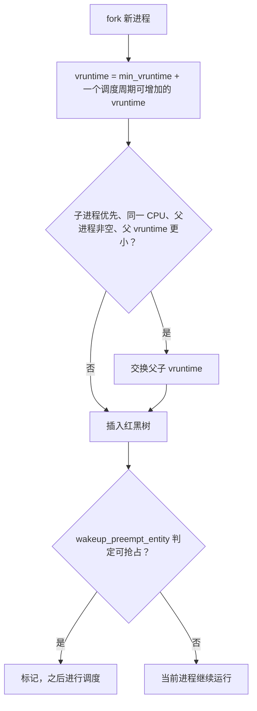
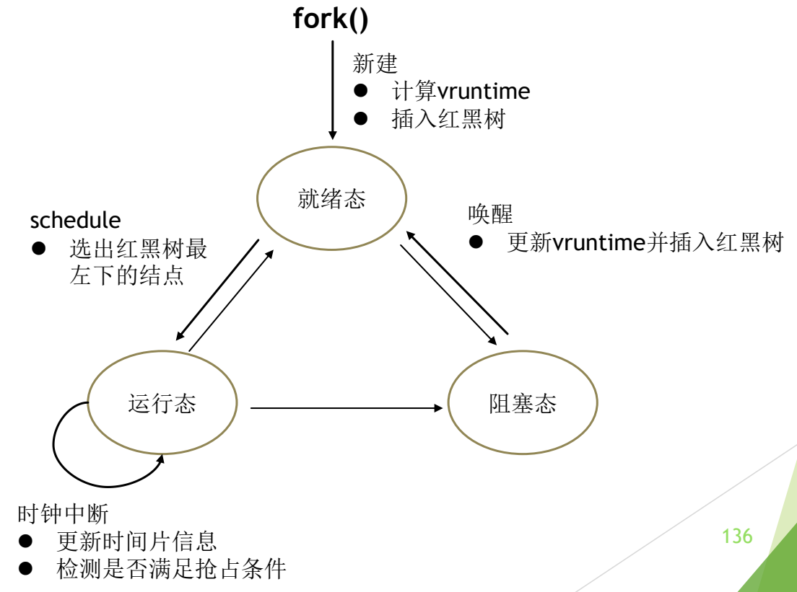

# 07 CFS 情景分析与 EEVDF

[本讲目录](../index.md) · [课程目录](../../index.md) · [上一节：06 CFS 完全公平调度](06-cfs-vruntime-and-red-black-tree.md)

> [!abstract] 本节要点
> - **时钟中断**：每次都把这段实际运行时间折算为 vruntime 累加；只有累计运行超过本调度周期内分配给它的时间才打标记并重新调度，否则继续运行。
> - **主动调度**：更新当前进程运行信息 → 插回红黑树 → 选择下一个 → 移出红黑树；选择时 cfs_rq 的 next（刚被调度上 CPU 的抢占者）优先、last（刚被调度出去的进程）次之，选完清空，并用 `wakeup_preempt_entity` 判断：只有 vruntime 小过调度粒度才抢占。
> - **进程创建**：$\text{vruntime} = \text{min\_vruntime} + \text{一个调度周期内可增加的 vruntime}$（假装已运行过一轮）；满足四个条件时交换父子 vruntime，让子进程先运行。
> - **进程唤醒**：取 $\max(\text{min\_vruntime} - \text{补偿值},\ \text{原 vruntime})$，既补偿长睡眠者，又防止靠频繁睡眠获取额外时间；唤醒抢占也有门槛，避免频繁切换。
> - **EEVDF**（讲义标为 Linux 6.11，主线实际于 6.6 合入）本质仍是 CFS 的补丁：在公平之外考虑延迟，引入两个新指标；Linux 调度细节不要求记忆。

## 时钟中断与主动调度

[CFS 完全公平调度](06-cfs-vruntime-and-red-black-tree.md)给出了框架，但何时更新 vruntime、何时换人、换谁，要按情景分别规定。CFS 分四种情景：时钟中断、主动调度、进程唤醒、进程创建。[^s1p128] 这与 Windows 按“主动让出、被动等待、时间片到”划分场景的思路类似，也回答了上一节提出的几个细节问题。[^s3b7]

### 情景一：时钟中断

时钟中断时 CFS 做两件事：[^s1p129]

1. **更新进程运行信息**：把当前进程这一段的实际运行时间按公式 2 换算为 vruntime，加到原来的 vruntime 上。
2. **判断是否满足抢占条件**：如果当前进程这一段实际运行的时间超过了一个调度周期内分配给它的时间（公式 1 的结果），就做标记，随后主动进行一次进程调度；否则继续运行当前进程。

时钟中断**不等于**时间片到。之所以每次时钟中断都要累加 vruntime，是因为只有这样才知道进程到底运行了多久；累计超过本周期的分配量（相当于“时间配额到”）才触发重新调度。[^s3b7]

> [!example] 例：时钟中断中的判断
> A 的权重为 NICE_0_LOAD，本调度周期分得 10 ms，时钟中断每 4 ms 一次。
>
> 1. 第 1 次中断：A 已运行 4 ms，vruntime $+4$；$4 < 10$，继续运行。
> 2. 第 2 次中断：累计 8 ms，vruntime 再 $+4$；$8 < 10$，继续运行。
> 3. 第 3 次中断：累计 12 ms $> 10$，打上需要重新调度的标记，随后进行一次主动调度。

### 情景二：主动调度

进程让出 CPU（或被标记需要重新调度）时，执行标准的四步：[^s1p130]

1. **更新当前进程运行信息**（vruntime 等）；
2. **将当前进程插入红黑树**（按新 vruntime 定位）；
3. **选择要运行的进程**；
4. **将该进程移出红黑树**。

第 3 步并不是简单取红黑树最左侧结点。cfs_rq 有两个与调度策略关系很大的指针：[^s1p131]

- **last**：指向最近被调度出去的进程；
- **next**：指向被调度上 CPU 的进程。

例如 A 正在运行时被 B 抢占，则 last 指向 A，next 指向 B。选择下一个进程时，若这两个指针不为 NULL，**优先选 next，其次选 last**，选完后清空这两个指针。

这种优先选择是通过 `wakeup_preempt_entity(cfs_rq->next, se)` 与 `wakeup_preempt_entity(cfs_rq->last, se)` 实现的，即使从 next/last 中选，也要再计算一次是否值得。函数返回值的含义：[^s1p132]

| 返回值 | 条件 | 能否抢占 |
| --- | --- | --- |
| $-1$ | 新进程的 vruntime 大于当前进程 | 不能抢占 |
| $0$ | 新进程的 vruntime 比当前进程小，但没有小到调度粒度 | 一般也不能抢占 |
| $1$ | 新进程的 vruntime 比当前进程小，且差值超过调度粒度 | 可以抢占 |

**调度粒度**是一个阈值：vruntime 只差一点点就换人，切换开销会超过公平带来的好处，所以要求差值超过粒度才抢占。

> [!note] 补充解释
> 在经典 CFS 源码的 `pick_next_entity()` 中，先取最左结点 left，然后用 `wakeup_preempt_entity(cfs_rq->next, left) < 1` 判断：只要 left 没有比 next“领先”超过调度粒度，就选 next（last 同理）。也就是说 next/last 的优待是有限度的，不会以明显破坏公平为代价。

## 进程创建与进程唤醒

这两个情景回答“新进程 vruntime 初值是不是 0”和“休眠进程唤醒时会不会立刻抢占”。它们都依赖一个基准量。

**min_vruntime** 是每个 cfs 队列一个的变量，一般小于等于所有就绪态进程的最小 vruntime，体现目前所有进程整体虚拟运行时间的**下限**。[^s1p134] 新进程和刚醒来的进程都以它为参照，而不是用 0 或自己过时的旧值。

### 情景三：进程创建

新建进程不是立刻投入运行，而是：[^s1p133]

1. **更新新进程的 vruntime**：以 cfs 队列的 min_vruntime 为基准，再加上进程在一次调度周期中能够增加的 vruntime，相当于假设新进程在这一轮调度中已经运行过了。这样它既不会因 vruntime 为 0 而长期独占 CPU，也不会落后太多。
2. **必要时交换父子 vruntime**：新进程 vruntime 确定后进行判断，满足特定条件就交换父子进程的 vruntime。
3. **将新建进程插入红黑树**。
4. **判断当前进程能否被新建进程抢占**：调用 `wakeup_preempt_entity`，满足抢占条件则标记，之后进行调度。

同时满足以下条件时，交换父子进程的 vruntime：[^s1p134]

- sysctl 设置了子进程优先运行；
- fork 出的子进程与父进程在同一个 CPU 上；
- 父进程不为空；
- 父进程的 vruntime 小于子进程的 vruntime。

交换的目的是让子进程更快地运行：父进程 vruntime 更小时，把这个较小值给子进程，子进程就排到父进程前面。[^s3b7]

### 情景四：进程唤醒

进程睡眠（例如等待 I/O）期间 vruntime 不变，而其他进程的 vruntime 在增长。唤醒时的处理：[^s1p135]

1. **调整唤醒进程的 vruntime**：用 min_vruntime 减去一个值，作为对睡眠进程的补偿，使它醒来时能较快得到 CPU。但有些进程只睡眠很短时间，醒来后 vruntime 仍大于 min_vruntime，不能让进程通过睡眠获得额外的运行时间，所以最终取**计算出的补偿值与进程原本 vruntime 中的较大者**：

$$
\text{vruntime}_{\text{新}} = \max\bigl(\text{min\_vruntime} - \text{补偿值},\ \text{vruntime}_{\text{原}}\bigr)
$$

2. **将唤醒进程插入红黑树**。
3. **判断是否满足调度条件**：醒来并不一定立刻抢占。若醒来就切换，会造成频繁切换，因此设有门槛——只有与当前进程的 vruntime 差值超过门槛，才设置重新调度标志、换人；差值不大就不换。[^s3b8]

> [!example] 例：长睡眠与短睡眠进程醒来
> 设 min_vruntime $=100$，补偿值为 $6$，则候选值 $=94$。
>
> 1. X 睡了很久，原 vruntime $=50$：新 vruntime $=\max(94, 50)=94$。X 得到补偿、排在前面，但不会以 50 这样极小的值长时间独占 CPU。
> 2. Y 只睡了一下，原 vruntime $=98$：新 vruntime $=\max(94, 98)=98$。Y 保持原值，频繁短睡眠换不到额外时间。

> [!note] 补充解释
> 经典 CFS 源码（`place_entity()`）中，唤醒补偿值取调度延迟 `sysctl_sched_latency`，启用 GENTLE_FAIR_SLEEPERS 时取其一半。这一取值课上未讲，仅供理解“补偿有上限”。

> [!warning] 易错点
> 唤醒补偿**不是**“睡得越久补偿越多”。补偿以当前 min_vruntime 为参照、最多补偿一个固定值；睡得再久，新 vruntime 也不会低于 $\text{min\_vruntime} - \text{补偿值}$。

## CFS 与进程状态转换

四种情景其实就是 CFS 的调度策略，与进程模型的状态转换一一对应：[^s1p136] [^s3b8]

- **新建**（fork）→ 就绪态：计算 vruntime，插入红黑树；
- **schedule**（就绪态 → 运行态）：选出红黑树最左下的结点；
- **时钟中断**（运行态）：更新时间片信息，检测是否满足抢占条件——时钟中断不一定立即切换；
- **唤醒**（阻塞态 → 就绪态）：更新 vruntime 并插入红黑树。

图：fork() 新建进程时计算 vruntime 并插入红黑树；schedule 选出红黑树最左下结点运行；时钟中断更新时间片并检测抢占；唤醒时更新 vruntime 并重新插入红黑树。

进程状态模型见 L04「03 三状态模型」。

## EEVDF 调度器

讲义的演化图在 CFS 之后标出了 **Linux 6.11 的 EEVDF 调度器**。[^s1p105] EEVDF 本质仍是 CFS，但 CFS 只追求公平，EEVDF 在公平之外还考虑**延迟**，希望延迟最短，为此引入了两个新的指标。[^s3b8]

> [!warning] 易错点：EEVDF 的合入版本
> 讲义写的是“Linux 6.11 EEVDF 调度器”。按主线内核记录，EEVDF 于 **Linux 6.6**（2023 年 10 月）合入，取代 CFS 的选择逻辑；6.12 又合入剩余部分（如 delayed dequeue）。记版本时以 6.6 为准。参见 [内核文档：EEVDF Scheduler](https://docs.kernel.org/scheduler/sched-eevdf.html)。

> [!info] 可视化资源
> - [Linux 内核文档：EEVDF Scheduler](https://docs.kernel.org/scheduler/sched-eevdf.html)：看 lag（与公平份额的差）和 virtual deadline 两个新指标，正好对应课堂派调研题；注意该文档写的是自 6.6 起逐步替代 CFS。

> [!tip] 课堂强调
> 这次 Linux 调度算法**不需要记**，因为算法太复杂；需要了解的是 EEVDF 为什么要给 CFS 打补丁、改进了哪些方面。[^s3b8]

> [!note] 补充解释
> **EEVDF**（Earliest Eligible Virtual Deadline First，最早合格虚拟截止时间优先）的两个指标通常指 **lag（滞后量）/合格性** 与 **虚拟截止时间**（virtual deadline）：
>
> 1. **lag**：进程“理应得到的服务”与“实际得到的服务”之差。lag $\ge 0$ 表示它得到的少于应得的份额，称为**合格**（eligible），只有合格的进程才能被选中；lag $<0$ 的进程已经多跑了，要先等别人追上。
> 2. **虚拟截止时间**：进程按自己请求的时间片长度和权重算出的“应在何时完成这一片”的虚拟时间，约为合格起点 $+\ \text{请求时间片}/\text{权重}$。
> 3. **选择规则**：在所有合格进程中，选虚拟截止时间最早者运行。请求较短时间片的延迟敏感进程截止时间更早、更早被选中，但每次只能跑一小片，整体 CPU 份额仍由权重决定。
>
> 由此，EEVDF 用 lag 保证公平，用虚拟截止时间区分延迟需求，取代了 CFS 中依赖启发式补偿（如唤醒补偿）的做法。

## 重点小结与源码阅读

> [!info] 依据讲义整理
> 本小节内容来自讲义的总结页与源码阅读页，课上未讲解。

调度部分（L06–L08）涉及的重点：[^s1p137]

1. **调度相关的基本概念**：调度的层次、进程的行为、调度算法的设计目标（见 L06「02 调度层次与处理器调度」「05 调度目标与衡量指标」）。
2. **典型的调度算法**（设计思想及应用）：FCFS、RR、SPN、SRT、HRRN、Feedback（见 L07「01 批处理系统的调度算法」「02 时间片轮转与虚拟轮转」「05 多级队列与多级反馈队列」）。
3. **Linux 进程调度算法**（本讲 [Linux 2.4 与 O(1) 调度器](04-linux-scheduler-evolution-2-4-and-o1.md) 至本章）与 **Windows 线程调度算法**（见 L07「07 Windows 线程调度」）。
4. **调度的时机**与**进程切换过程**（见 L06「03 调度时机」「04 进程切换与上下文切换」）。

**源代码阅读**：阅读并理解 xv6 中与进程线程调度相关的代码 `kernel/swtch.S`、`kernel/proc.h`、`kernel/proc.c`，可参考 xv6 手册 §7.1–§7.4。[^s1p138]

> [!note] 补充解释
> 在 xv6（RISC-V 版）中，`swtch.S` 实现上下文切换：把当前内核线程的 `ra`、`sp` 和被调用者保存寄存器 `s0`–`s11` 存入旧的 `struct context`，再从新的 context 恢复；`proc.h` 定义 `struct proc`（进程状态、内核栈、context 等）、`struct context` 与 `struct cpu`；`proc.c` 中的 `scheduler()` 是每个 CPU 上循环寻找 RUNNABLE 进程并切换过去的调度循环，`sched()`、`yield()`、`sleep()`/`wakeup()` 负责让出 CPU 与睡眠唤醒。xv6 用的是最简单的轮转式选择，可与 Linux 的 CFS 对照阅读。手册第 7 章 Scheduling 的 §7.1–§7.4 依次讲多路复用、上下文切换代码、调度代码和 `mycpu`/`myproc`。

> [!question]- 自测：某 cfs 队列 min_vruntime $=200$，一个调度周期内新进程可增加的 vruntime 为 $8$。父进程 P 的 vruntime 为 $203$，sysctl 设置了子进程优先，子进程 C 与 P 在同一 CPU。fork 后 C 和 P 的 vruntime 各是多少？
> C 的初值为 $200+8=208$。四个交换条件全部满足（子进程优先、同一 CPU、父进程非空、父 $203 <$ 子 $208$），于是交换：C 得到 $203$，P 得到 $208$，C 会排在 P 前面先运行。

> [!question]- 自测：当前进程 vruntime 为 300，刚唤醒的进程 W 调整后 vruntime 为 298，调度粒度对应的差值为 4。W 会立即抢占吗？若 W 为 290 呢？
> 298 时不会：W 虽比当前进程小，但差值 2 未超过粒度，`wakeup_preempt_entity` 返回 0，一般不抢占，避免频繁切换。290 时差值 10 超过粒度，返回 1，设置重新调度标记，W 抢占当前进程。

> [!question]- 自测：时钟中断到来，当前进程累计运行时间尚未超过本周期分配给它的时间，但树中已有 vruntime 比它小的进程。CFS 会在此时切换吗？时钟中断这一步还做了什么？
> 按讲义的时钟中断规则不会：只要累计运行未超过本周期分配量，就继续运行当前进程。但这一步仍必须把本段实际运行时间折算成 vruntime 累加到它的 vruntime 上，否则无法判断它到底运行了多久。

> [!info]- 来源
> - slides04.pdf：PDF p.105, 128–138
> - L08.docx：DOCX body 140–190

[^s1p128]: slides04.pdf-PDF p.128
[^s3b7]: L08.docx-DOCX body 140-160
[^s1p129]: slides04.pdf-PDF p.129
[^s1p130]: slides04.pdf-PDF p.130
[^s1p131]: slides04.pdf-PDF p.131
[^s1p132]: slides04.pdf-PDF p.132
[^s1p134]: slides04.pdf-PDF p.134
[^s1p133]: slides04.pdf-PDF p.133
[^s1p135]: slides04.pdf-PDF p.135
[^s3b8]: L08.docx-DOCX body 161-190
[^s1p136]: slides04.pdf-PDF p.136
[^s1p105]: slides04.pdf-PDF p.105
[^s1p137]: slides04.pdf-PDF p.137
[^s1p138]: slides04.pdf-PDF p.138

[本讲目录](../index.md) · [课程目录](../../index.md) · [上一节：06 CFS 完全公平调度](06-cfs-vruntime-and-red-black-tree.md)
