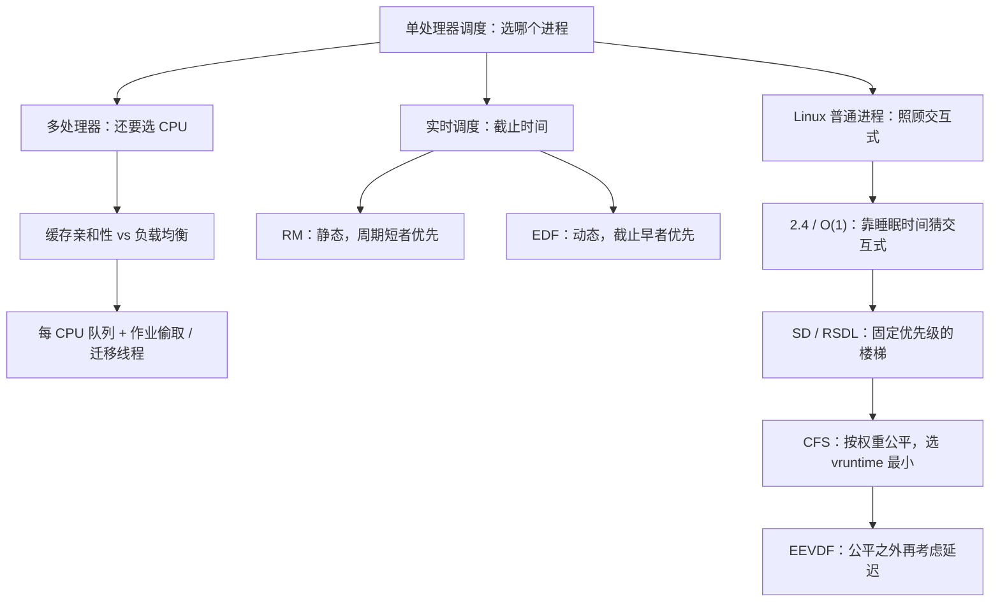

# L08 多处理器与 Linux 调度

[课程目录](../index.md)

单处理器调度只回答“下一个运行谁”；多处理器和实际内核还要回答“在哪个 CPU 上运行”“截止时间能否保证”“怎样既公平又照顾交互式进程”。本讲先讨论 SMP 下的就绪队列组织、缓存亲和性与负载均衡（01–02），再讲实时调度的可调度性、RM 与 EDF（03），最后沿 Linux 调度器演化史从 2.4、O(1)、SD/RSDL 走到 CFS 的 vruntime 与四种情景，并说明 EEVDF 的改进方向（04–07）。前置知识是 L06「05 调度目标与衡量指标」中的调度指标和 L07「05 多级队列与多级反馈队列」中的 MLFQ。

## 章节导航

- [01 多处理器调度的基本问题](chapters/01-multiprocessor-scheduling-basics.md)：多处理器还要选 CPU：全局队列与每 CPU 队列之争
- [02 多核缓存问题与负载均衡](chapters/02-multicore-cache-and-load-balancing.md)：亲和性与负载均衡的矛盾，作业偷取及其实例
- [03 实时调度](chapters/03-real-time-scheduling-rm-edf.md)：可调度性条件、RM 充分条件与 EDF
- [04 Linux 2.4 与 O(1) 调度器](chapters/04-linux-scheduler-evolution-2-4-and-o1.md)：进程分类、2.4 的 counter 与 O(1) 双数组
- [05 楼梯调度 SD 与 RSDL](chapters/05-staircase-sd-and-rsdl.md)：SD 固定优先级下楼梯，RSDL 配额限时
- [06 CFS 完全公平调度](chapters/06-cfs-vruntime-and-red-black-tree.md)：按权重分配 CPU，选 vruntime 最小者运行
- [07 CFS 情景分析与 EEVDF](chapters/07-cfs-scenarios-and-eevdf.md)：四种情景细节、min_vruntime 与 EEVDF

## 本讲小结

本讲的三条线索都在回答“除了选哪个进程，还要权衡什么”：多处理器要在亲和性与负载均衡之间折中，实时调度要保证截止时间，Linux 调度器则经历了从“猜测谁是交互式进程”到“按权重完全公平”的转变。

| 调度器 | 选择方式 | 如何对待交互式进程 | 主要问题 |
| --- | --- | --- | --- |
| Linux 2.4 | 遍历 runqueue 比较 counter 与 nice | 睡眠进程重算时累加未用完的 counter | 开销随进程数增长，非抢占 |
| O(1) | active/expired 数组 + 位图 | 平均睡眠时间换算 bonus | 经验公式难懂，识别常失效 |
| SD / RSDL | 固定优先级，用完时间片（或 $T_p$）降一级 | 睡眠者留在高层，相当于补偿 | 已被 CFS 取代 |
| CFS | 红黑树最左结点（vruntime 最小） | 不区分，只按权重；唤醒时有限补偿 | 只管公平，不管延迟 |

### 核心公式

| 公式 | 含义 |
| --- | --- |
| $\sum_{i=1}^{m} C_i/P_i \le 1$ | 周期任务可调度的必要条件；也是 EDF（单处理器、可抢占、截止时间等于周期）的充要条件 |
| $U \le n(2^{1/n}-1)$ | RM 的充分条件，$n\to\infty$ 时趋于 $\ln 2 \approx 0.693$ |
| $\text{分配时间} = \text{调度周期} \times \frac{\text{进程权重}}{\text{总权重}}$ | CFS 公式 1：按权重分配真实时间 |
| $\text{vruntime} = \text{实际运行时间} \times \frac{\text{NICE\_0\_LOAD}}{\text{进程权重}}$ | CFS 公式 2：NICE_0_LOAD 是 nice 0 的权重 1024 |
| $\text{vruntime}_{\text{新}} = \max(\text{min\_vruntime} - \text{补偿值},\ \text{vruntime}_{\text{原}})$ | CFS 唤醒补偿，防止靠频繁睡眠获利 |

## 不确定事项

- 课堂派 EEVDF 调研题教师未点名“两个指标”；笔记按内核文档写作 lag 与 virtual deadline，并标为补充解释。
- CFS 跨 CPU 迁移时 vruntime 的处理课上只提问未作答，笔记的 min_vruntime 相对化说明为补充解释（基于 6.6 前的经典 CFS）。
- 草稿中未出现 SLUB 相关内容（属 L09），无需核对。

> [!info]- 来源
> - slides04.pdf：PDF p.77–138
> - L08.docx：DOCX body 1–190
