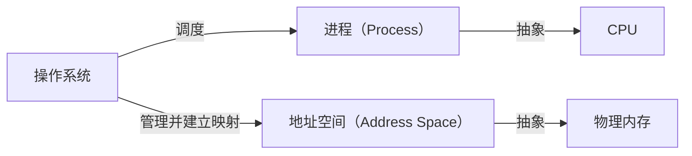
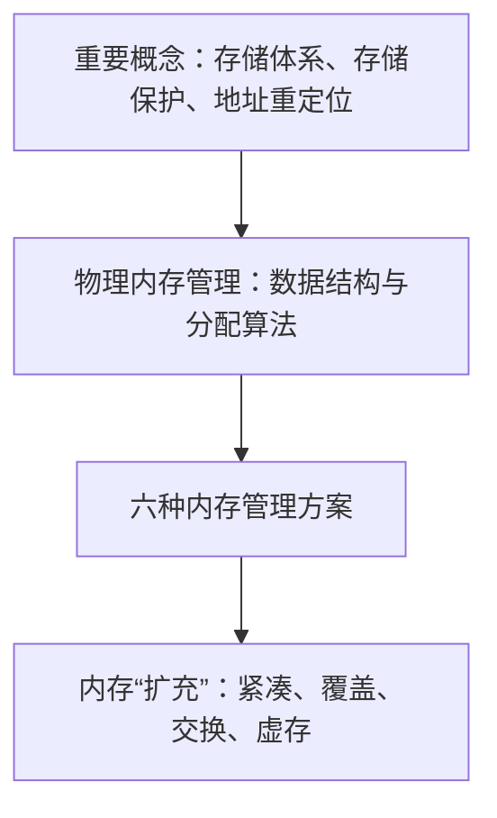

# 01 内存管理的任务

[本讲目录](../index.md) · [课程目录](../../index.md) · [下一节：02 地址绑定与重定位](02-address-binding-and-relocation.md)

> [!abstract] 本节要点
> - 创建进程必须拿到三样资源：PID、PCB 和地址空间（一块内存），所以内存管理与进程模型密不可分。
> - 内存管理 $\neq$ 虚存管理：先弄清“纯粹的”内存管理要解决什么，再看它如何演化成今天的虚存。
> - **地址空间**是对内存的抽象，正如进程是对 CPU 的抽象；OS 管理地址空间，以及地址空间到物理内存的映射（映射需要硬件支持）。
> - 两个空间对应两类地址：逻辑地址与物理地址；二者之间的转换称为地址重定位，也叫地址转换、地址变换、地址翻译、地址映射。
> - 内存管理更高的要求是存储保护（不越界、不越权）与存储共享；虚存得以成立靠两个支点：局部性原理和存储体系。

## 为什么需要内存管理

进程要运行，就必须在内存里有一块属于它的地方。创建进程有几个固定的标准步骤：分配一个进程标识 PID，分配一个进程控制块 PCB，再给它一个**地址空间**，用最传统的说法就是“分配一块内存”。这三样是进程创建后必须拿到的资源。[^s4b1] 所以内存管理最朴素的任务就是：进程要内存，操作系统就给它内存。

这也解释了为什么教材 OSTEP（*Operating Systems: Three Easy Pieces*，可免费在线阅读）把进程（CPU 虚拟化）和内存虚拟化一起放在第一部分“虚拟化”里：二者是一体的，讲内存管理时要把进程模型的知识串起来。早期 UNIX 的内核结构中，内存管理模块也与进程控制紧密相连。

今天大家熟悉的是**虚存**（virtual memory）：操作系统给进程的是一块虚拟内存，运行中需要哪部分内容，才把磁盘上的内容真正放进物理内存并建立映射。但**内存管理不等于虚存管理**。本讲先回到早期，看最纯粹的内存管理要解决什么问题、遇到了什么困难，再看它如何一步步演化成今天的虚存、演化后为什么更好；虚存本身留到下一讲。

本讲围绕以下问题展开：[^s2p2]

1. 内存管理从简单到复杂的演化过程是什么？
2. 怎样理解“地址空间（address space）是对内存的抽象”？
3. 内存管理追求哪些目标？
4. 程序什么时候进入内存？
5. 进程空间与物理内存空间怎么对应？
6. 物理内存如何分配？空闲空间怎么管理，有哪些数据结构和算法？
7. 怎样“扩充”内存？
8. Linux 伙伴系统、SLAB/SLUB/SLOB 的作用是什么？

## 地址空间：内存的抽象

操作系统管理计算机的各种资源：CPU、内存、磁盘和各种设备。它并不直接管 CPU，而是管**进程**：进程是对 CPU 的抽象，OS 通过调度进程上 CPU，间接地把 CPU 管起来。内存也是同样的思路。[^s4b1]

> [!info] 可视化资源
> - [OSTEP 第 13 章 地址空间（PDF）](https://pages.cs.wisc.edu/~remzi/OSTEP/vm-intro.pdf)：看图 13.1–13.3：从早期单进程独占内存到多进程共享内存，再到代码、堆、栈组成的地址空间示例。

**地址空间**（address space）是对内存的抽象。引入这层抽象后，系统中就有了两个空间：

- **进程地址空间**：每个进程看到的那个“框”，今天也就是它的虚存；
- **物理内存空间**：真实的存储单元。

操作系统要做两件事：管好进程的地址空间，并完成地址空间到物理内存的映射。这个映射功能需要硬件支持，具体机制见 [地址绑定与重定位](02-address-binding-and-relocation.md)。

## 逻辑地址、物理地址与地址重定位

两个空间各有自己的地址：

- **逻辑地址**（logical address）：进程地址空间中的地址；
- **物理地址**（physical address）：物理内存中存储单元的地址。

CPU 执行指令时，指令里的地址属于地址空间，要访问真正的存储单元，就要把它转换成物理地址。这个转换过程叫**地址重定位**（address relocation）：一条指令在地址空间里有一个地址，要“重新定位”到它在物理内存中的位置。同一件事还有多种叫法，可以混用，即**地址转换、地址变换、地址翻译、地址映射**。[^s2p3] 两类地址的严格定义、绑定时机和静态/动态重定位见 [地址绑定与重定位](02-address-binding-and-relocation.md)。

> [!tip] 课堂强调
> “重要概念”页第一行左边两个（地址重定位、逻辑地址/物理地址）是本讲的重点。[^s4b1]

## 存储保护、存储共享与内存管理方案

在地址转换之上，内存管理还有两项更高的要求：[^s2p3]

- **存储保护**：分两方面。一是**不越界**，进程只能访问属于自己的那块空间，不能“出圈”；二是**不越权**，比如某块区域只允许读，就不能对它做写操作。
- **存储共享**：不同进程可以共享物理内存中的同一块区域（例如同一个物理页面）。

越界保护的具体硬件机制见 [地址保护与地址空间](03-protection-evolution-and-address-space.md)。

从最早到今天，内存管理方案一共六种：**单一连续区、固定分区、可变分区、页式、段式、段页式**。今天的系统基本以页式为主（ICS 课程学的就是页式），但理解另外几种方案有助于看清演化脉络，详见 [连续分配方案](06-contiguous-allocation-schemes-and-compaction.md) 和 [页式与段式管理](07-paging-segmentation-and-segmented-paging.md)。

历史上程序越来越大，而内存昂贵、容量小，于是出现了“大程序如何在小内存上运行”的问题，相应有两种内存“扩充”技术：**覆盖技术**和**交换技术**。覆盖技术只流行过一段时间，今天已经不用；交换技术则是今天虚存的基础，虚存就是交换技术再加页式。[^s4b2] 两者的细节见 [覆盖与交换技术](08-memory-expansion-overlaying-and-swapping.md)。

本讲的整体结构如下：[^s2p4]

## 局部性原理与存储体系

地址空间这套机制发展到今天的虚存，之所以能很好地支撑整个系统运行，靠的是两个支点。[^s4b1]

**局部性原理**（principle of locality）：程序在一段时间内访问的地址往往集中在一个小范围内。缓存设计正是利用这一点：设计 L1、L2、L3 多级缓存，访问越多地在 L1 命中，性能就越好。

**存储体系**（memory hierarchy）：从快到慢、从小到大依次是寄存器、L1/L2/L3 高速缓存、内存、本地磁盘、远程磁盘。[^s2p15] 今天说的“内存”已经不只是一块物理内存：虚存把物理内存、磁盘甚至云盘都算了进来，构成一个存储体系。[^s4b2]

存储体系越往上速度越快、容量越小、单位价格越高。局部性原理保证了大多数访问能落在上层，存储体系则让下层的大容量成为上层的后备，两者合起来才使“地址空间比物理内存大”成为可能。

> [!question]- 自测：为什么说“OS 管内存实际上是在管地址空间”？试用 CPU 的例子类比。
> 因为 OS 并不直接操作物理内存单元，而是给每个进程一个地址空间，再负责地址空间到物理内存的映射。这与 OS 不直接管 CPU、而是通过管理进程（CPU 的抽象）并调度其上 CPU 来间接管理 CPU 完全对应。

> [!question]- 自测：一位同学说“内存管理就是虚存管理”，这种说法哪里不准确？
> 虚存是内存管理演化到今天的形态。早期的内存管理（如单一连续区、分区）要求整个进程一次性、连续地装入物理内存，没有虚拟地址空间，也没有按需调入。内存管理是更大的范畴，虚存只是其中最新的一种方案。

> [!info]- 来源
> - slides05.pdf：PDF p.1–5, 15
> - L09.docx：DOCX body 1–58

[^s4b1]: L09.docx-DOCX body 1-35
[^s2p2]: slides05.pdf-PDF p.2
[^s2p3]: slides05.pdf-PDF p.3
[^s4b2]: L09.docx-DOCX body 36-58
[^s2p4]: slides05.pdf-PDF p.4
[^s2p15]: slides05.pdf-PDF p.15

[本讲目录](../index.md) · [课程目录](../../index.md) · [下一节：02 地址绑定与重定位](02-address-binding-and-relocation.md)
