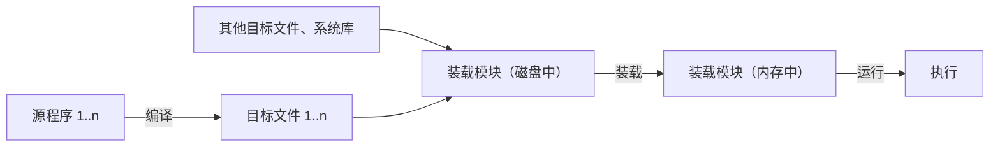
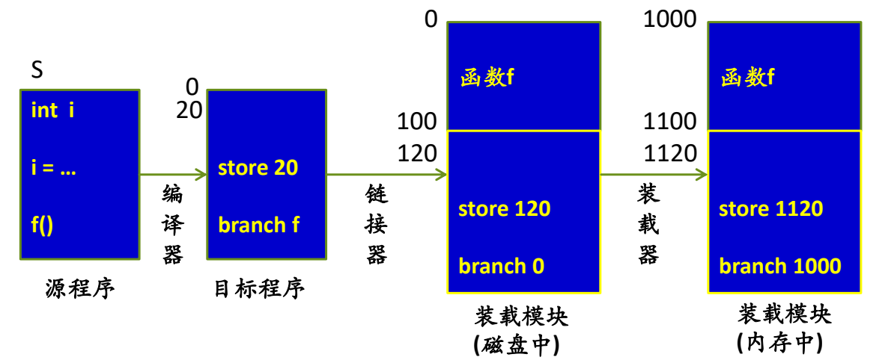
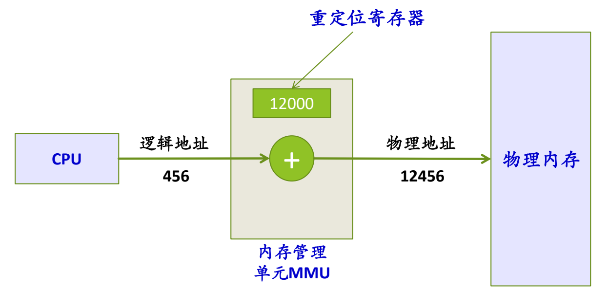
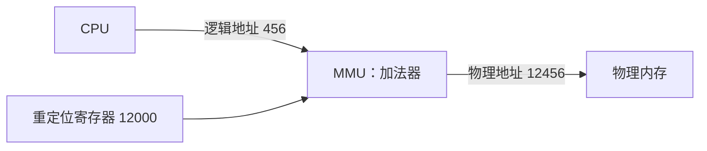

# 02 地址绑定与重定位

[本讲目录](../index.md) · [课程目录](../../index.md) · [上一节：01 内存管理的任务](01-memory-management-tasks-key-concepts.md) · [下一节：03 地址保护与地址空间](03-protection-evolution-and-address-space.md)

> [!abstract] 本节要点
> - 程序执行前要经过编译 → 链接 → 装载 → 运行；地址可以在这四个时机中的任何一个绑定到物理地址，但各有约束。
> - 逻辑地址（相对地址）以 0 为首地址，不能直接访存；物理地址（绝对地址）可直接寻址。严格配对：逻辑↔物理、相对↔绝对、虚拟↔实。
> - **静态重定位**：装载时由软件一次性改写所有地址，例如 `store 20` → 链接后 `store 120` → 装入 1000 处后 `store 1120`；之后程序不能移动。
> - **动态重定位**：装载时不改地址，每条指令执行时才转换，必须由硬件 MMU 完成。
> - 最早的 MMU 只是一个重定位寄存器：物理地址 = 重定位寄存器 + 逻辑地址，如 $12000 + 456 = 12456$。

## 程序执行前的准备过程

“程序什么时候进入内存”这个问题，要从源程序变成运行中的进程的整个过程说起。[^s2p6]

1. **编译**：每个源程序（`.c`）被编译成一个目标文件（`.o`）。
2. **链接**：链接器把多个目标文件，加上其他目标文件和系统库，链接成一个**装载模块**，也就是磁盘上的可执行文件（它有自己的文件格式，这里不关心格式）。
3. **装载**：装载器（loader）把装载模块从磁盘读入内存。
4. **运行**：CPU 执行内存中的指令。

这里关心的是：在这条流水线上，**何时把指令和数据绑定到内存地址**，也就是何时完成地址转换。

## 地址绑定的四个时机

**地址绑定**（address binding）指把程序中的指令地址、数据地址确定为物理内存地址。可选的时机有四个：Compile time、Linking time、Load time、Run time。[^s2p7] 四个时机在技术上都可行，但各有约束，或者没有必要这样做。[^s4b2]

| 绑定时机 | 能否做到 | 前提与问题 |
| --- | --- | --- |
| 编译时（compile time） | 可以 | 必须事先知道程序在物理内存的起点，且只有一个 `.c` 文件。例如已知程序从 1000 开始装入，变量 `i` 的相对地址 200 可直接改成 1200。但实际程序有多个 `.o`，谁在前谁在后编译时还不知道，所以没人这样做 |
| 链接时（linking time） | 可以 | 多个 `.o` 链接后先后顺序和各自长度都已确定，可以改成物理地址，但同样需要预知装入起点，实际也不这样做 |
| 装载时（load time） | 可以 | 装载器此时知道程序放在哪里，逐条把地址改掉即可，很早以前就是这么做的。缺点是程序装入后就不能移动，要“搬家”就得把所有地址重改一遍 |
| 运行时（run time） | 可以 | 今天的做法：CPU 拿到的不是物理地址，执行时再转换成物理地址，最灵活 |

## 逻辑地址与物理地址

两类地址的概念见 [内存管理的任务](01-memory-management-tasks-key-concepts.md)，它们的严格定义如下。[^s2p8]

- **逻辑地址**（相对地址、虚拟地址）：用户程序经过编译、汇编后形成目标代码，目标代码通常采用相对地址的形式，首地址为 0，其余指令中的地址都相对于首地址编址。**不能用逻辑地址直接在内存中读取信息。**
- **物理地址**（绝对地址、实地址）：内存中存储单元的地址，可以直接寻址。

**地址重定位**就是把用户程序中的逻辑地址转换为运行时可由机器直接寻址的物理地址的过程，目的是保证 CPU 执行指令时能正确访问内存单元。

> [!warning] 易错点
> 从严格意义上说，术语是成对的：**逻辑↔物理、相对↔绝对、虚拟↔实（real）**。现在习惯说“虚拟地址对物理地址”，因为“实地址”不好听。讨论时要清楚自己说的是哪个空间的地址，不要把不同配对的词混用而说错空间。[^s4b2]

## 静态地址重定位

**静态地址重定位**（static relocation）：用户程序加载到内存时，一次性完成逻辑地址到物理地址的转换，一般可以由软件（装载器）完成。[^s2p9]

用一个例子跟踪地址的变化。源程序 S 中声明了整型变量 `i`，有赋值 `i = …`，并调用了定义在另一个源文件中的函数 `f()`。

1. **编译后（目标程序）**：S 的目标代码首地址为 0，变量 `i` 被分配在相对地址 20，赋值语句编译成 `store 20`；`f` 不在本文件，调用编译成 `branch f`。函数 `f` 另有自己的目标程序。
2. **链接后（磁盘中的装载模块）**：链接器把函数 `f` 放在前面，占 0–100；S 接在后面从 100 开始。于是 `i` 的地址从 20 变为 $100 + 20 = 120$，指令变成 `store 120`；`f` 从 0 开始，调用变成 `branch 0`。这时地址仍是相对地址，只是换成了整个可执行文件内的新相对地址。
3. **装载后（内存中的装载模块）**：假设装载模块从物理地址 1000 开始存放，`f` 占 1000–1100，S 从 1100 开始。装载器把所有地址都加上 1000：`store 120` → `store 1120`，`branch 0` → `branch 1000`。

图：源程序经编译器、链接器、装载器三步，看 `store 20` 变为 `store 120` 再变为 `store 1120`、`branch f` 变为 `branch 0` 再变为 `branch 1000`，装载时一次性把逻辑地址加上装入起址 1000。

上图从左到右依次是源程序、目标程序、磁盘中的装载模块和内存中的装载模块，标出了编译器、链接器、装载器三步各自做的改写。真正改成物理地址的只有最后一步，即装载时，这就是“静态”重定位。

静态重定位的问题在于：装入后所有地址都已固定，程序只能待在这个位置；要换位置，就得把所有地址重新改一遍。而且它默认整个进程一次性全装进内存，程序很大、有些部分根本不执行时，这种做法就很浪费。[^s4b3]

## 动态地址重定位与 MMU

**动态地址重定位**（dynamic relocation）：装载时不改地址，在进程执行过程中逐条指令完成地址映射。[^s2p10] 在同样的例子中，编译、链接两步不变，装入内存（从 1000 开始）后指令仍是 `store 120`、`branch 0`，直到执行时才映射到物理地址。

> [!info] 可视化资源
> - [OSTEP 第 15 章 地址转换（PDF）](https://pages.cs.wisc.edu/~remzi/OSTEP/vm-mechanism.pdf)：看图 15.2 单个重定位进程在物理内存中的位置，以及图 15.3/15.4 动态重定位对硬件与 OS 的要求。

由于**每执行一条指令都要做一次地址转换**，用软件做必然太慢，必须由专门的硬件完成。这个部件就是**内存管理单元**（Memory Management Unit, MMU）：CPU 发出逻辑地址，经 MMU 转换为物理地址后再访问物理内存。[^s4b3]

最早的 MMU 只有一个**重定位寄存器**（relocation register），记录当前进程在物理内存中的起始地址；每个逻辑地址都加上它，就得到物理地址：[^s2p11]

$$
\text{物理地址} = \text{重定位寄存器的值} + \text{逻辑地址}
$$

例如重定位寄存器为 12000，CPU 发出逻辑地址 456，则物理地址为 $12000 + 456 = 12456$。

图：CPU 发出逻辑地址 456，MMU 将其与重定位寄存器中的 12000 相加，得到物理地址 12456 后访问物理内存。

图中 CPU 发出的逻辑地址 456 经过 MMU 中的加法器与重定位寄存器 12000 相加，得到物理地址 12456 再去访问物理内存。思路和装载时改地址一样，都是“起点 + 相对地址”，区别只在于它推迟到每条指令执行时由硬件完成。今天 MMU 框里的机制已换成虚存的那套映射（页表等，见 [页式与段式管理](07-paging-segmentation-and-segmented-paging.md)），但“CPU 发出逻辑地址、MMU 转换后访存”的结构没有变。

| 比较维度 | 静态重定位 | 动态重定位 |
| --- | --- | --- |
| 转换时机 | 装载时一次性完成 | 每条指令执行时 |
| 谁来完成 | 软件（装载器） | 硬件（MMU） |
| 内存中的代码 | 已改写为物理地址（`store 1120`） | 保持相对地址（`store 120`） |
| 程序能否移动 | 不能，移动需重改全部地址 | 能，只需修改重定位寄存器 |

> [!question]- 自测：在静态重定位的例子中，如果装载器把装载模块放在 3000 而不是 1000，`store 120` 和 `branch 0` 会变成什么？若采用动态重定位呢？
> 静态重定位：所有地址加 3000，变成 `store 3120`、`branch 3000`。动态重定位：内存中的指令仍是 `store 120`、`branch 0`，重定位寄存器置为 3000，执行 `store 120` 时 MMU 算出物理地址 3120。

> [!question]- 自测：为什么编译时绑定在实际中不可行，而运行时绑定一定需要硬件？
> 编译时绑定要求事先知道装入起点，而且只能有一个源文件；多个 `.o` 的排列顺序要到链接时才确定，起点要到装载时才知道。运行时绑定意味着每条访存指令都要转换一次地址，软件开销无法接受，只能由 MMU 用硬件完成。

> [!info]- 来源
> - slides05.pdf：PDF p.6–11
> - L09.docx：DOCX body 36–88

[^s2p6]: slides05.pdf-PDF p.6
[^s2p7]: slides05.pdf-PDF p.7
[^s4b2]: L09.docx-DOCX body 36-58
[^s2p8]: slides05.pdf-PDF p.8
[^s2p9]: slides05.pdf-PDF p.9
[^s4b3]: L09.docx-DOCX body 59-88
[^s2p10]: slides05.pdf-PDF p.10
[^s2p11]: slides05.pdf-PDF p.11

[本讲目录](../index.md) · [课程目录](../../index.md) · [上一节：01 内存管理的任务](01-memory-management-tasks-key-concepts.md) · [下一节：03 地址保护与地址空间](03-protection-evolution-and-address-space.md)
