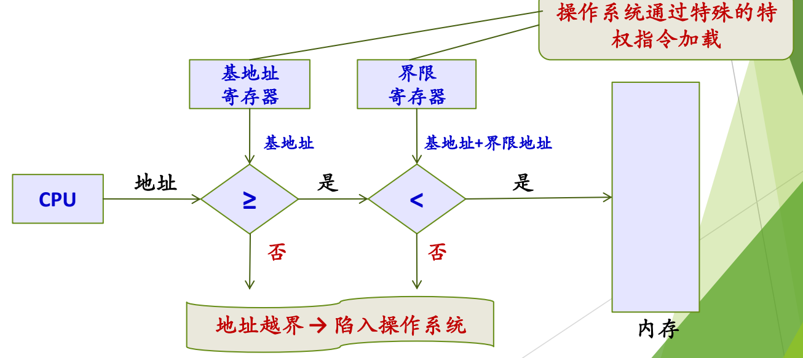
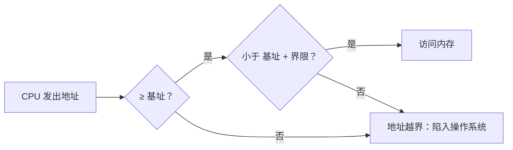
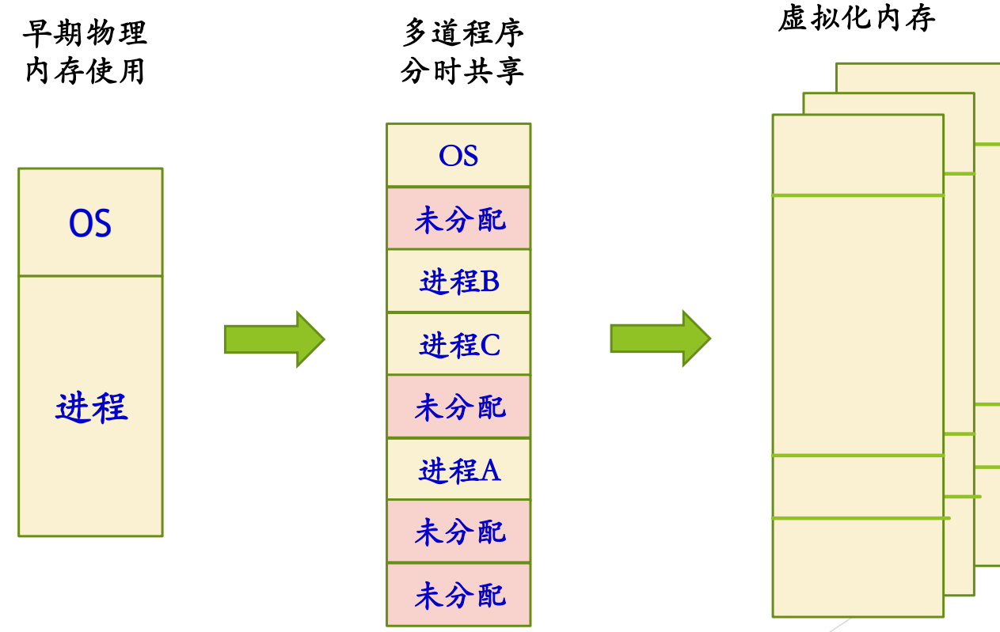

# 03 地址保护与地址空间

[本讲目录](../index.md) · [课程目录](../../index.md) · [上一节：02 地址绑定与重定位](02-address-binding-and-relocation.md) · [下一节：04 空闲内存管理与分配](04-free-physical-memory-management-and-allocation.md)

> [!abstract] 本节要点
> - 多道程序下多个进程同时在内存，每个进程只能访问 $[\text{基址}, \text{基址}+\text{界限})$ 内的地址，否则陷入 OS；基址/界限寄存器由 OS 用特权指令加载。
> - 整进程连续装入越来越难，出路是三个转变：连续性 → 离散性、驻留性 → 交换性、一次性 → 多次性，页式由此而来。
> - 演化路线：早期单进程独占 → 多道程序分时共享（整进程连续装入）→ 虚拟化内存；今天 x86-64 Linux 的地址空间为 $2^{48}$，远大于 16G/32G 物理内存。
> - 虚拟地址空间的特点：巨大、统一一致、私有（越界问题天然消失，只剩越权），再加稀疏。
> - 内存管理的基本功能：分配地址空间、加载（建立与可执行文件各 section 的映射）、保护、共享、最小化访问时间；Linux 用 `vm_area_struct` 的起始地址、结束地址、flags、protection 描述一个区域。

## 越界保护：基址寄存器与界限寄存器

早期的做法是把一个进程的整个地址空间**连续地**放进物理内存。多道程序设计让多个进程同时在内存里：进程 A、B、……、Z 各占一段，操作系统也在内存中。[^s2p12] 每个程序长短不一样（大程序和 hello world 所需空间差别很大），只要进程要运行，就在物理内存中找一块地方把它整个放进去。

> [!info] 可视化资源
> - [OSTEP 第 15 章 地址转换（PDF）](https://pages.cs.wisc.edu/~remzi/OSTEP/vm-mechanism.pdf)：重点看图 15.5/15.6：启动时与运行时 OS 和硬件如何配合加载 base/bounds、越界时陷入 OS。

图：CPU 给出的地址先与基地址比较（$\ge$），再与基地址+界限地址比较（$<$），两项都为“是”才访问内存，任一为“否”则地址越界并陷入操作系统；两个寄存器由操作系统通过特权指令加载。

这时就有了第一个问题：进程 Z 执行时访问的任何地址都必须落在自己那一段里，既不能低于它的下界，也不能高于它的上界，更不能进入别的进程或操作系统的空间。这就是**地址越界保护**。[^s4b3] 地址保护有两层含义：[^s2p13]

- 确保每个进程有独立的地址空间；
- 确定进程可以访问的合法地址范围，确保进程只访问合法地址。

只有一个重定位寄存器（起始地址）只能做转换，做不了检查，所以要增加一个寄存器：

- **基址寄存器**（base register）：进程在物理内存中的起始地址；
- **界限寄存器**（limit register）：进程地址空间的长度。

每次访存时，硬件对地址做两次比较：

1. 地址 $\ge$ 基址？否则越界；
2. 地址 $<$ 基址 + 界限？否则越界；
3. 两项都满足才访问内存；任一不满足即**地址越界，陷入操作系统**。

基址寄存器和界限寄存器由操作系统通过**特殊的特权指令**加载，用户进程不能自己修改。[^s2p13] 因此，在那个时期，地址转换（地址映射）时必须同时考虑保护。

> [!example] 例：判断是否越界
> 某进程基址为 30000，界限为 12000，合法范围是 $[30000, 42000)$。
>
> 1. 访问 35000：$35000 \ge 30000$ 且 $35000 < 42000$，合法。
> 2. 访问 42000：$42000 < 42000$ 不成立，越界，陷入 OS（上界是开区间）。
> 3. 访问 29999：小于基址，越界。

## 从连续到离散：要解决的第二个问题

第二个问题是：进程越来越大，要为它在物理内存中找到一整块连续空间越来越难。[^s4b3] 出路就是今天已经普遍接受的三个转变：[^s2p14]

- **连续性 → 离散性**：把一个进程切成几块（页），在内存中各找一块空位放进去，逻辑上的一页对应物理内存中的一页，只要有空位就能放。页式管理就是这样来的。
- **驻留性 → 交换性**：驻留指进程一进内存就一直待到运行结束才归还；交换指进程还没运行完也可以先出内存，过一会儿再进来。
- **一次性 → 多次性**：不必一次全部装入，可以分多次进入内存。

这样就不必为整个进程找一块连续空间，内存管理变得灵活得多。页式的细节见 [页式与段式管理](07-paging-segmentation-and-segmented-paging.md)，交换见 [覆盖与交换技术](08-memory-expansion-overlaying-and-swapping.md)。

## 已成为常识的前提

下面这些今天已经是常识，也是讨论内存管理的前提：[^s2p15]

- **多道程序设计模型**：允许多个程序同时进入内存，正因如此才需要考虑越界等问题；
- **程序装载到内存才可以运行**：程序以文件形式（可执行文件格式）保存在磁盘上；
- **每个进程有自己独立的地址空间**：一个进程执行时不能访问另一个进程的地址空间，任何进程也不能访问操作系统所在的空间；
- **不能执行不适当的操作**：例如只允许读的区域不能写；
- 局部性原理与存储体系（见 [内存管理的任务](01-memory-management-tasks-key-concepts.md)）。

**为什么有了多道程序，内存管理就要多做很多工作？** 因为同时有多个用户程序在内存中：[^s2p16]

1. **需要支持地址重定位**：程序中的地址不一定是最终的物理地址，因为程序运行前无法确定它会被加载到内存什么地方，也就算不出物理地址；
2. **需要支持地址保护**：进程之间不能互相访问对方的内存。

## 内存管理的演化与虚拟地址空间

内存管理从最简单到今天的虚存，大致经过以下几个阶段：[^s2p17]

图：从早期单个进程独占内存（OS+进程），到多道程序分时共享（OS 与进程 A/B/C 及若干未分配区共存），再到每个进程各自一份虚拟化内存的三个阶段。

图中从左到右：早期内存里只有 OS 和一个进程，这个进程运行完，整个换出，新的进程再进来；多道程序阶段内存中有 OS、进程 A/B/C 和若干未分配区，新进程到来时找一块足够大的空闲区放进去，但仍以整个进程为单位连续装入；最后是虚拟化内存，每个进程都拥有一个很大的虚拟地址空间。中间还经历过把进程分成多块、不连续存放的阶段，这里从略。[^s4b4]

今天每个进程的地址空间比物理内存大得多。例如 x86-64 Linux 的进程地址空间为 $2^{48}$ 字节（256 TB），而机器的物理内存通常只有 16G 或 32G，根本放不下。之所以可行，是因为地址空间按页划分后离散存放，并不要求所有页都在内存中，需要时才调入。[^s4b4]

ICS 课程总结了虚拟地址空间的三个特点，为了在 PCB 中描述它，又加上第四个：[^s4b4]

1. **巨大**：每个进程一个地址空间，范围非常大；
2. **统一一致**：每个进程的内存布局都一样；
3. **私有**：每个进程独占自己的整个地址空间，不论怎样寻址都出不了这个圈，所以**地址越界问题天然被解决**，只剩下**越权**问题；
4. **稀疏**：巨大的空间中只有少数区域真正在用，PCB 中描述地址空间的数据结构要能表达这种稀疏性。

> [!warning] 易错点
> 基址/界限寄存器解决的是多个进程共处一块物理内存时的**越界**问题。到了虚存时代，每个进程的地址空间私有，越界不再是问题，保护的重点变成**越权**（读/写/执行权限）。不要把两个时代的保护机制混为一谈。

## 内存管理的基本功能

内存管理的基本功能有五项：[^s2p18]

1. **给进程分配内存**：今天就是进程一创建，就给它一个地址空间（虚存）。
2. **往内存加载内容**：把进程地址空间映射到物理内存。
3. **存储保护**：防止地址越界，检查访问权限。
4. **共享内存**（后续讲次再讲）。
5. **最小化存储访问时间**：已知的手段之一就是缓存（cache），访问命中缓存就不必去内存取。

对第 2 项要理解清楚：**地址空间的内容是设计（约定）出来的，真正的内容在磁盘上**。设计好“这块放代码、这块放数据”之后，建立地址空间实际上只是在地址空间与**可执行文件**的各个 section（代码、数据等）之间建立映射；把地址空间再映射到物理内存，是下一步的事。[^s4b4]

在 Linux 中，地址空间的每个区域用一个 `vm_area_struct` 结构描述，其中最重要的四项信息是：

- **起始地址**（start）：该区域的起点，例如代码 section 映射到地址空间后的起点；
- **结束地址**（end）：该区域的终点；
- **标志**（flags）；
- **保护属性**（protection）：该区域的访问权限。

栈区在磁盘上的可执行文件中没有对应内容，但它同样是一个区域，同样有保护属性（例如不可执行）。

> [!tip] 课堂强调
> `vm_area_struct` 中的起始地址、结束地址、flags、protection 这四项信息一定要记住。[^s4b4]

> [!note] 补充解释
> 在 Linux 源码中，这几个字段的实际名称是 `vm_start`、`vm_end`、`vm_flags` 和 `vm_page_prot`（见 [include/linux/mm_types.h](https://elixir.bootlin.com/linux/latest/source/include/linux/mm_types.h)）。一个进程的所有 `vm_area_struct` 由其 `mm_struct` 统一管理。

**虚拟化内存**还要满足三项要求：[^s2p18]

- **透明性**：用户进程不关心内存如何管理，只要能运行就好；
- **效率**；
- **保护**。

虚存能同时满足这三项，因此也满足了内存管理的基本要求。

## 进程地址空间的布局

地址空间的布局就是一种**约定**：规定好什么东西放在哪里，大家就知道到哪里去找。程序的地址应当与物理内存地址无关。[^s4b5] 关于地址空间要能回答三个问题：有什么内容？从哪里加载到地址空间？具体放在什么位置？[^s2p19]

> [!info] 可视化资源
> - [xv6 RISC-V 教材 rev4（MIT 6.1810，PDF）](https://pdos.csail.mit.edu/6.1810/2024/xv6/book-riscv-rev4.pdf)：看图 2.3 进程虚拟地址空间布局与图 3.4 用户地址空间及初始栈（布局属考核内容）。

各区域的含义与来历已在 L04「06 进程地址空间」讲过，这里只列出经典 32 位 Linux 的布局作为对照（从低地址到高地址）：[^s2p19]

| 区域 | 起始地址（示意） | 说明 |
| --- | --- | --- |
| 只读的代码和数据 | `0x08048000` | 代码段 |
| 读/写数据 | 紧接代码之后 | 数据段 |
| 运行时堆 | 数据段之后，向高地址增长 | 运行时由 `malloc` 创建 |
| 共享库的存储器映射区域 | `0x40000000` | 共享库、内存映射文件 |
| 用户栈 | `0xc0000000` 以下，向低地址增长 | 运行时创建 |
| 内核虚拟存储器 | `0xc0000000`–`0xffffffff` | 内核空间 |

简化来看，地址空间分为高处的内核地址空间和低处的用户地址空间；用户地址空间中从低到高是代码段（PC 指向这里）、数据段、堆，最上面是栈（SP 指向这里），此外还有共享库、内存映射文件等内容。[^s2p20]

代码、数据和共享库的内容都来自磁盘上的可执行文件或库文件，堆和栈在磁盘上没有对应内容，运行时才创建；这一区别决定了换出进程时只需写出堆和栈（见[覆盖与交换技术](08-memory-expansion-overlaying-and-swapping.md)）。

**xv6 的地址空间**布局相对简单（定义见 `kernel/memlayout.h`）：[^s2p21]

- 地址从低到高依次为 text、data & bss、stack、heap……；
- 高地址处有 trampoline 和 trapframe，它们在用户态和内核态都有映射。

> [!tip] 课堂强调
> xv6 的地址空间布局较简单，课后要去读，这部分属于将来的考核内容。[^s4b5]

有了地址空间，最终还要把它的内容装进物理内存，因此还要把物理内存的**空闲空间**组织起来，负责分配、回收、分割与合并，详见 [空闲内存管理与分配](04-free-physical-memory-management-and-allocation.md)。英文文献把“分配”称为 **placement**（放置），与 **replacement**（置换）同根，读文献时要认得。[^s4b5]

> [!question]- 自测：某进程基址寄存器为 0x4000，界限寄存器为 0x1000。CPU 依次访问 0x4FFF 和 0x5000，结果分别如何？谁负责设置这两个寄存器？
> 合法范围是 $[\text{0x4000}, \text{0x5000})$。访问 0x4FFF 合法；访问 0x5000 不满足“小于基址+界限”，越界，陷入操作系统。两个寄存器由操作系统用特权指令加载，用户程序无权修改。

> [!question]- 自测：为什么说在虚拟地址空间中“越界”问题天然消失，而“越权”问题仍然存在？
> 每个进程的虚拟地址空间是私有的，进程无论怎样寻址都只能落在自己的空间里，碰不到别的进程。但同一个地址空间内部的不同区域权限不同（如代码只读、栈不可执行），对只读区写入这类越权访问仍需要通过 `vm_area_struct` 的保护属性等机制来检查。

> [!info]- 来源
> - slides05.pdf：PDF p.12–21
> - L09.docx：DOCX body 59–146

[^s2p12]: slides05.pdf-PDF p.12
[^s4b3]: L09.docx-DOCX body 59-88
[^s2p13]: slides05.pdf-PDF p.13
[^s2p14]: slides05.pdf-PDF p.14
[^s2p15]: slides05.pdf-PDF p.15
[^s2p16]: slides05.pdf-PDF p.16
[^s2p17]: slides05.pdf-PDF p.17
[^s4b4]: L09.docx-DOCX body 89-119
[^s2p18]: slides05.pdf-PDF p.18
[^s4b5]: L09.docx-DOCX body 120-146
[^s2p19]: slides05.pdf-PDF p.19
[^s2p20]: slides05.pdf-PDF p.20
[^s2p21]: slides05.pdf-PDF p.21

[本讲目录](../index.md) · [课程目录](../../index.md) · [上一节：02 地址绑定与重定位](02-address-binding-and-relocation.md) · [下一节：04 空闲内存管理与分配](04-free-physical-memory-management-and-allocation.md)
