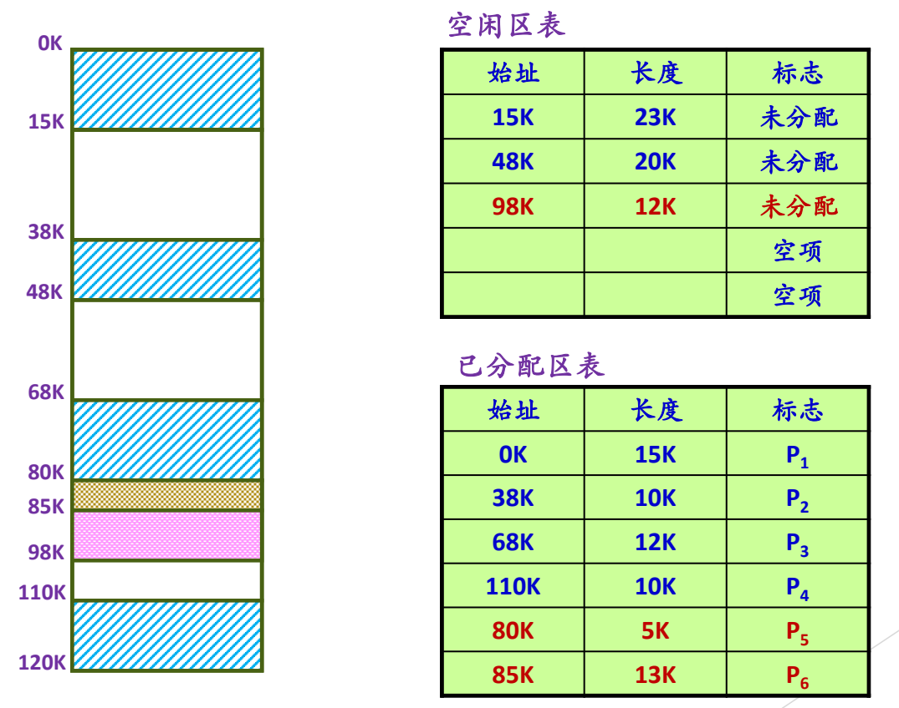
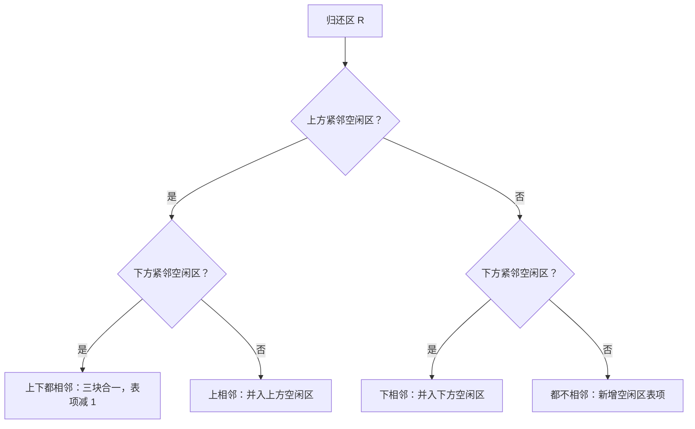

# 04 空闲内存管理与分配

[本讲目录](../index.md) · [课程目录](../../index.md) · [上一节：03 地址保护与地址空间](03-protection-evolution-and-address-space.md) · [下一节：05 伙伴系统与 SLAB](05-segregated-fit-buddy-system-and-slab.md)

> [!abstract] 本节要点
> - 物理内存管理只管空闲部分：分出去的不再管，归还后重新纳入空闲管理；本质是数据结构与算法问题。
> - 等长划分（页框）用位图，每个单元 1 位；不等长划分（可变分区）用空闲区表/已分配区表或空闲块链表（隐式、显式、分离）。
> - 衡量指标有两类：内存利用率（内碎片、外碎片）和性能（分配延迟、CPU 开销）。
> - 首次、下次、最佳、最差四种适配都是“切出所需部分，剩余成为新空闲区”，所以才有碎片；省搜索时间就要花排序时间，首次适配仍常用。
> - 回收时按上相邻、下相邻、上下都相邻、上下都不相邻四种情况合并，并修改空闲区表。

## 两种划分与对应的数据结构

把地址空间的内容装进物理内存，就要知道物理内存中哪些地方是空的。**物理内存管理只管空闲的部分**：分出去之后就不再管，归还回来再变成空闲并重新管起来。所以这本质上是一个数据结构与算法问题。[^s4b5]

物理内存的划分方式有两种，分别对应不同的数据结构：[^s2p23]

- **等长划分**：把物理内存划分成大小相同的单元，例如今天页式管理中的页框（page frame）。
- **不等长划分**：每个空闲区大小不等，例如传统的可变分区。

三种数据结构中，位图适合等长划分，空闲区表和空闲块链表适合不等长划分。

### 位图

**位图**（bitmap，位示图）：每个分配单元对应位图中的一位，0 表示空闲，1 表示占用（也可以反过来）。[^s2p23] 一位的信息量很小，但对等长划分已经够用：

- 若进程需要**连续** 10 页，就在位图中找连续 10 个 0；
- 若**不要求连续**，就逐个找 0，找到一个分一个，跳过中间的 1 继续找。[^s4b5]

### 空闲区表与已分配区表

不等长划分不能用位图，改用表格。**空闲区表**（或**已分配区表**）的每一项记录一个空闲区（或已分配区）的**起始地址、长度、标志**。[^s2p23] 可以用两张表分别记录空闲区和已分配区，也可以合成一张表、用标志区分空闲与已分配。表的大小事先不知道，通常设计得比较大，所以会有许多没有意义的“空项”。[^s4b5]

> [!info] 可视化资源
> - [OSTEP 第 17 章 空闲空间管理（PDF）](https://pages.cs.wisc.edu/~remzi/OSTEP/vm-freespace.pdf)：看图 17.4/17.6 空闲链表嵌在堆中如何被切分，以及最佳/最差/首次/下次适配的比较。

### 空闲块链表

空闲区也可以组织成**空闲块链表**，有隐式空闲链表、显式空闲链表、分离空闲链表三种，ICS 课程的 malloc 实验中都实现过。[^s2p23]

## 衡量指标与碎片

不论等长还是不等长划分，追求的目标都是一样的：[^s2p24]

- **内存资源利用率**：尽可能减少资源浪费，关注**内碎片**和**外碎片**；
- **性能**：尽可能降低分配延迟，节约 CPU 资源。

> [!note] 补充解释
> **内碎片**（internal fragmentation）是分给进程的区域内部没有用上的部分，例如按固定大小的页或分区分配时，最后一块装不满；**外碎片**（external fragmentation）是夹在已分配区之间、太小而难以再分配出去的空闲区。哪种方案产生哪种碎片，在 [连续分配方案](06-contiguous-allocation-schemes-and-compaction.md) 和 [页式与段式管理](07-paging-segmentation-and-segmented-paging.md) 中分别讨论。

这类分配算法在数据结构中很常见，也可以参考 Knuth《计算机程序设计艺术》中的相关内容。[^s4b5]

## 四种分配算法

四种适配算法的区别只在于**选哪个空闲区**：[^s2p25]

- **首次适配**（first fit）：在空闲区表中找到第一个满足进程要求的空闲区；
- **下次适配**（next fit）：从上次找到的空闲区处接着往下查找；
- **最佳适配**（best fit）：查找整个空闲区表，找到能满足进程要求的**最小**空闲区；
- **最差适配**（worst fit）：总是分配满足进程要求的**最大**空闲区。

选中之后的处理都一样：**把该空闲区分为两部分，一部分给进程使用，另一部分形成新的空闲区。**[^s2p25] 算法并不是把整个空闲区都给进程，而是切出所需的大小，剩余部分留作空闲。正因为不断切分，才会出现碎片问题。[^s4b5]

> [!warning] 易错点
> “最差适配”的“差”不是说算法差，而是指它挑**最大**的空闲区来切。切完后剩下的空闲区仍然比较大，还能继续使用。

至于哪种算法更好，其实并不重要：如果每次要找最小或最大的空闲区，要么分配时逐个查找花时间，要么空闲区归还时维护排序花时间，总要在某处付出代价。所以简单的**首次适配**至今仍被常用。[^s4b5]

## 分配示例

初始时内存 0K–120K 的使用情况如下，有三个空闲区：[^s2p26]

| 区间 | 长度 | 状态 |
| --- | --- | --- |
| 0K–15K | 15K | $P_1$ |
| 15K–38K | 23K | 空闲 |
| 38K–48K | 10K | $P_2$ |
| 48K–68K | 20K | 空闲 |
| 68K–80K | 12K | $P_3$ |
| 80K–110K | 30K | 空闲 |
| 110K–120K | 10K | $P_4$ |

对应的空闲区表为（15K, 23K, 未分配）、（48K, 20K, 未分配）、（80K, 30K, 未分配），其余为空项；已分配区表为 $P_1$–$P_4$ 四项。

> [!example] 例：判断所用的分配算法
> 1. 进程 $P_5$ 申请 5K，系统从 80K 处分出 80K–85K。空闲区表中原来的（80K, 30K）变为（85K, 25K），已分配区表增加（80K, 5K, $P_5$）。
> 2. 判断算法：三个空闲区分别是 23K、20K、30K，系统选的是最大的 30K；切出 5K 后剩下的 25K 仍然是最大的空闲区。如果是首次适配，应选 15K 处的 23K 区；如果是最佳适配，应选 20K 区。所以这里用的是**最差适配**。[^s4b5]
> 3. 进程 $P_6$ 再申请 13K，仍从当前最大的 25K 区（85K 处）切出 85K–98K。空闲区表变为（15K, 23K）、（48K, 20K）、（98K, 12K），已分配区表增加（85K, 13K, $P_6$），此时已分配区表已经用满。[^s2p27]

图：左侧 0K–120K 的内存布局与右侧两张表对应，空闲区表记录 15K/23K、48K/20K、98K/12K 三个未分配区，已分配区表记录 $P_1$–$P_6$ 的始址与长度，对照每项的始址和长度找到图中位置。

图中左侧是内存布局，新增的 80K–85K 和 85K–98K 两段分别分给 $P_5$ 和 $P_6$；右侧是两次分配后空闲区表和已分配区表的变化过程。

## 回收与合并

内存不是无限的，用完要收回来。**内存回收算法**：某一块归还后，与前后的空闲空间合并，并修改空闲区表。[^s2p28] 设归还区为 $R$，按它与相邻空闲区的位置关系分四种情况：

| 情况 | 含义 | 空闲区表的变化 |
| --- | --- | --- |
| 上相邻 | $R$ 的上方（低地址侧）紧挨一个空闲区 | 与上方空闲区合并：该表项长度增加，起始地址不变 |
| 下相邻 | $R$ 的下方（高地址侧）紧挨一个空闲区 | 与下方空闲区合并：该表项起始地址改为 $R$ 的起址，长度增加 |
| 上下都相邻 | 两侧都是空闲区 | 三块合成一块：保留一个表项，删除另一个，表项数减 1 |
| 上下都不相邻 | 两侧都已分配 | 新增一个表项记录 $R$ |

也就是说，回收后可能三个空闲区合成一个，可能两个合成一个，也可能新增一个空闲区。[^s4b6]

按大小分类组织空闲块以减少搜索开销，就是**分离适配**的思想，Linux 伙伴系统即属于这一类，见 [伙伴系统与 SLAB](05-segregated-fit-buddy-system-and-slab.md)。

> [!question]- 自测：在示例的初始状态（空闲区 23K、20K、30K，依地址顺序排列）下，进程申请 18K。首次适配、最佳适配、最差适配分别从哪个起始地址分配？分配后新空闲区多大？
> 首次适配：第一个能放下 18K 的是 15K 处的 23K 区，分出 15K–33K，剩下（33K, 5K）。最佳适配：能放下的最小区是 48K 处的 20K 区，分出 48K–66K，剩下（66K, 2K）。最差适配：最大的是 80K 处的 30K 区，分出 80K–98K，剩下（98K, 12K）。

> [!question]- 自测：接上例最终状态（$P_5$ 占 80K–85K，$P_6$ 占 85K–98K，98K–110K 空闲），若 $P_6$ 归还，属于哪种回收情况？空闲区表如何变化？
> $P_6$（85K–98K）上方是 $P_5$（已分配），下方紧邻空闲区 98K–110K，属于“下相邻”。合并后表项（98K, 12K）改为（85K, 25K）：起始地址前移到 85K，长度变为 $13+12=25$K，表项数不变。

> [!info]- 来源
> - slides05.pdf：PDF p.22–28
> - L09.docx：DOCX body 120–174

[^s4b5]: L09.docx-DOCX body 120-146
[^s2p23]: slides05.pdf-PDF p.23
[^s2p24]: slides05.pdf-PDF p.24
[^s2p25]: slides05.pdf-PDF p.25
[^s2p26]: slides05.pdf-PDF p.26
[^s2p27]: slides05.pdf-PDF p.27
[^s2p28]: slides05.pdf-PDF p.28
[^s4b6]: L09.docx-DOCX body 147-174

[本讲目录](../index.md) · [课程目录](../../index.md) · [上一节：03 地址保护与地址空间](03-protection-evolution-and-address-space.md) · [下一节：05 伙伴系统与 SLAB](05-segregated-fit-buddy-system-and-slab.md)
