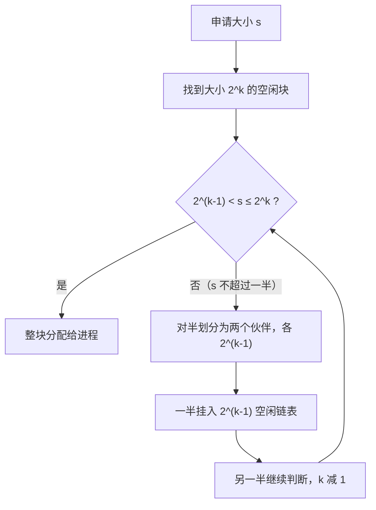
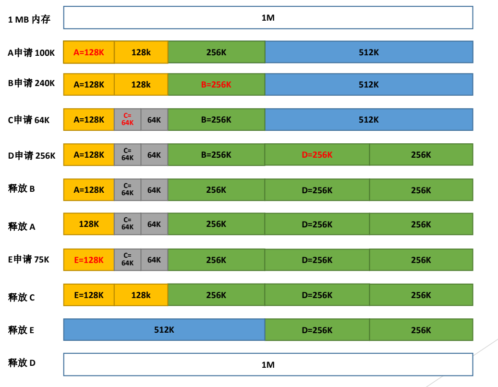

# 05 伙伴系统与 SLAB

[本讲目录](../index.md) · [课程目录](../../index.md) · [上一节：04 空闲内存管理与分配](04-free-physical-memory-management-and-allocation.md) · [下一节：06 连续分配方案](06-contiguous-allocation-schemes-and-compaction.md)

> [!abstract] 本节要点
> - **分离适配**按块大小分类，各类各维护一条空闲链表，分配时只搜索对应的类，从而减少搜索开销；伙伴系统、SLAB 和 PagedAttention 都是它的变体。
> - 伙伴系统把整块看作 $2^U$：若 $2^{U-1} < s \le 2^U$ 就把整块分配出去，否则一分为二，一直分到能容纳 $s$ 的最小块为止。
> - 只有从同一块一分为二得到的两块（buddy）才能合并；地址相邻但不是伙伴的两个空闲块不能合并。合并可以逐级连锁，一直合回更大的块。
> - SLAB 管理内核中频繁分配的小对象（PCB、inode、VMA 等），做法是“批发—零售”：先拿一大块内存预先切好，用时直接取。
> - SLUB 简化了数据结构，减少多核下的锁竞争，并针对 NUMA 做本地性设计；SLOB 力求极简紧凑，用于嵌入式和资源受限系统。

## 分离适配（Segregated Fit）

[首次、最佳等适配算法](04-free-physical-memory-management-and-allocation.md)每次分配都要在一条空闲链表上逐个查找，空闲块越多，搜索就越慢。**分离适配**（segregated fit）是内存管理和资源分配领域的经典思路：按块的大小把空闲块**分类**，每一类各自组织成空闲链表；申请时先根据大小确定类别，只在该类（或更大的类）中查找，从而减少搜索开销。[^s2p29]

这一思想有多种变体，适用于从嵌入式系统到大模型推理的各种场合：[^s2p30]

| 变体 | 特点 | 典型应用 |
| --- | --- | --- |
| 简单分离存储（Simple Segregated Storage） | 块大小固定，不分割也不合并 | 嵌入式实时系统（延迟可预测） |
| Segregated Fit | 允许分割大块，释放时可选择合并 | dlmalloc（Doug Lea malloc） |
| 伙伴系统（Buddy System） | 只允许 2 的幂大小，合并严格配对 | Linux 内核页分配、GPU 显存管理 |
| Slab 分配器（Slab Allocator） | 按**对象类型**分离，而不只按大小 | Linux 内核 kmalloc、对象缓存 |
| PagedAttention | 按 token 数分配 block，动态分配 | vLLM 的 KV Cache 管理 |

PagedAttention 说明这套几十年前的思想今天仍然适用：大模型推理时 KV Cache 的长度随生成的 token 数增长，把它切成固定大小的 block 按需分配，就是分离适配加上页式管理的思路。[^s4b6]

## 伙伴系统（Buddy System）

可变大小的分配容易产生大量难以合并的小空闲块。伙伴系统给块的大小和合并对象都加了限制，从而换来快速的分配与合并。Linux 内核底层的物理内存分配（包括 GPU 显存管理）采用的就是伙伴系统，它是一种特殊的分离适配算法。[^s2p31]

> [!info] 可视化资源
> - [维基百科：Buddy memory allocation](https://en.wikipedia.org/wiki/Buddy_memory_allocation)：看示例表格：1024K 内存逐行展示 A、B、C、D 申请时的分裂与释放时只与真伙伴合并，和课件 1MB 例子同构。
> - [OSTEP 第 17 章 图 17.8（PDF）](https://pages.cs.wisc.edu/~remzi/OSTEP/vm-freespace.pdf)：图 17.8 用二叉树画出伙伴系统的递归二分。

**伙伴系统**（buddy system）把内存按 2 的幂划分，相同大小的空闲块组成同一条空闲链表；分配时查找能满足请求的**最佳匹配块**。[^s2p31]

**分配算法**如下（设请求大小为 $s$）：

1. **初始状态**：把整个可用空间看作一块，大小为 $2^U$。
2. **判断是否整块分配**：若 $2^{U-1} < s \le 2^U$，即 $s$ 超过块的一半、又不超过整块，就把整个块分配出去。
3. **否则对半划分**：把块分成两个大小相等的**伙伴**（buddy），各为 $2^{U-1}$，取其中一块继续执行第 2 步，另一块挂到 $2^{U-1}$ 的空闲链表上。
4. **重复**，直到得到大于或等于 $s$ 的最小块。[^s2p31]

**回收规则**：块释放时，检查它的伙伴是否也空闲。若是，两者合并成大一倍的块，再用这个新块重复检查，可能一路合并上去（连锁合并）；若伙伴不空闲，就停在当前大小。关键在于**只有同一块一分为二得到的两块才是伙伴**，只有伙伴才能合并。[^s4b6]

### 1 MB 例子

下面的例子从 1 MB 空闲内存开始，内存布局从低地址写到高地址。[^s2p32]

| 操作 | 内存布局（低 → 高） | 过程说明 |
| --- | --- | --- |
| 初始 | 1M | 整块空闲 |
| A 申请 100K | A=128K, 128K, 256K, 512K | 1M→512K→256K→128K 逐级对半，$64 < 100 \le 128$，分配 128K |
| B 申请 240K | A, 128K, B=256K, 512K | 已有空闲 256K，$128 < 240 \le 256$，直接分配 |
| C 申请 64K | A, C=64K, 64K, B, 512K | 把第二个 128K 对半，分配 64K |
| D 申请 256K | A, C, 64K, B, D=256K, 256K | 没有空闲 256K，把 512K 对半 |
| 释放 B | A, C, 64K, 256K, D, 256K | 左侧 64K 空闲但不是伙伴，不合并 |
| 释放 A | 128K, C, 64K, 256K, D, 256K | A 的伙伴已被拆开且 C 在用，不合并 |
| E 申请 75K | E=128K, C, 64K, 256K, D, 256K | $64 < 75 \le 128$，直接用空闲 128K |
| 释放 C | E, 128K, 256K, D, 256K | C 与伙伴 64K 合成 128K；该 128K 的伙伴 E 在用，停止 |
| 释放 E | 512K, D, 256K | E+128K→256K，再与伙伴 256K→512K（连锁合并） |
| 释放 D | 1M | D+256K→512K，再与伙伴 512K→1M |

图：1 MB 内存依次处理 A 申请 100K、B 申请 240K、C 申请 64K、D 申请 256K 及后续释放，看块如何按 2 的幂对半拆分（如 512K→256K→128K→64K），以及释放后相邻伙伴如何合并回 512K 乃至 1M。

“释放 B”这一步最容易判断错：B 所在的 256K（地址 256K–512K）左边紧挨着一个 64K 空闲块，但 B 的伙伴是地址 0–256K 那一整块，而那块已被拆成 A、C 和 64K，所以 B 不能和任何块合并，只是多了一个 256K 空闲块。[^s4b6]

> [!warning] 易错点
> 判断能否合并要看**是否同出一块且大小相同**，不能只看地址是否相邻。例中 64K 空闲块和释放后的 256K 空闲块地址相邻，但大小不同、也不是从同一块分出来的，所以不能合并。

> [!note] 补充解释
> 伙伴系统总是按 $2^k$ 分配，请求大小不是 2 的幂时会产生内碎片：A 申请 100K 拿到 128K，浪费 28K；E 申请 75K 拿到 128K，浪费 53K。这是它用空间换取快速分配与合并的代价。伙伴的地址也很好算：大小为 $2^k$、起始地址为 $a$（$a$ 是 $2^k$ 的整数倍）的块，其伙伴起始地址为 $a \oplus 2^k$（按位异或），所以查找伙伴只需一次位运算。

## SLAB 分配器（SLAB Allocator）

用户空间的内存基本按页分配，比较简单；内核却要频繁地申请和释放大量**小对象**，例如创建进程要分配 PCB，创建文件要分配 inode，此外还有 VMA 等结构。这些对象往往远小于一页，如果每次都从伙伴系统现场分配，既慢又浪费。[^s4b6]

**SLAB 分配器**是 Linux 内核中用于运行时动态分配、释放内核内存的分配器，目标是可靠性和高性能。它由 Jeff Bonwick 在 20 世纪 90 年代最先在 Solaris 2.4 内核中设计实现。它把大块内存进一步细分成小块管理，只分配固定大小的内存块，块大小通常为 $2^n$ 字节（$3 \le n < 12$，即 8 B 到 2 KB）。[^s2p33]

它的思想可以概括为**批发—零售**：先从下层“批发”一大块内存，按对象大小预先切好，用时直接“零售”取一个。用户空间的堆也是批发零售，只不过发生在用户态。[^s4b6]

**实现方法**：[^s2p34]

1. **按大小分区**：把可用内存按对象大小划分为不同区域，每个区域有一个空闲对象列表。
2. **分配**：在大小合适的空闲对象列表中取一个与请求相符的空闲对象。
3. **释放**：把对象放回相应的空闲对象列表。
4. **缓存**：SLAB 有 slab cache，对象释放时优先放入本地高速缓存，下次分配可以直接复用。

SLAB 广泛用于文件系统、网络协议栈等内核模块。在 Linux 上可以用 `cat /proc/slabinfo`（通常需要 `sudo`）查看当前的 slab 缓存。[^s2p34]

> [!tip] 课堂强调
> 对 SLAB 系列只需知道“有这种分配器、它管理哪些对象、基本思路是什么”，具体实现不作要求。[^s4b6]

## SLAB 的问题与 SLUB、SLOB

**SLAB 的问题**：它维护的队列太多，实现日趋复杂，存储开销也随之增大；更关键的是，在高并发环境下多个 CPU 同时从同一队列取对象必须加锁，容易出现锁竞争，多核系统中性能下降。[^s2p35] 这和 L08「01 多处理器调度的基本问题」中的情形一样：所有 CPU 共用一个全局就绪队列时要加锁，竞争激烈；改为每个 CPU 一个队列，别的 CPU 不来争，锁竞争就少了。[^s4b6]

**改进一：SLUB**。为提高性能和可伸缩性，SLUB 采用更简单的数据结构，减少锁竞争，提高多核下的并发性能；它还可以针对体系结构优化，例如针对多核、多节点（NUMA）的本地性设计。NUMA 下访问离本节点近的内存比访问远的内存快，所以 SLUB 尽量从离当前 CPU 近的节点分配。SLUB 于 2007 年并入 Linux 2.6.22。[^s2p35]

**改进二：SLOB**。SLOB 是一个极简的内核内存分配器，设计目标是尽可能简单、紧凑，减少代码量和内存开销，适用于小型嵌入式系统和资源受限的环境。[^s2p36]

| 分配器 | 设计目标 | 适用场景 |
| --- | --- | --- |
| SLAB | 小对象预切分 + 缓存，高性能 | 通用内核小对象分配（早期默认） |
| SLUB | 简化结构、减少锁竞争、NUMA 本地性 | 多核、多节点服务器 |
| SLOB | 极简紧凑，代码和内存开销小 | 嵌入式、资源受限系统 |

> [!note] 补充解释
> 课件标注“SLUB 由 Pekka Enberg 开发”“SLOB 最早出现在 Linux 内核 2.2 版本”，与公开记录不符：SLUB 的作者是 Christoph Lameter（Pekka Enberg 当时是 slab 子系统的维护者之一），SLOB 由 Matt Mackall 编写，于 2.6.16（2006 年）并入主线。此外，近年的内核已移除 SLOB（6.4）和 SLAB（6.8），目前 SLUB 是唯一的 slab 分配器。参见 [Linux 内核文档：SLUB](https://docs.kernel.org/mm/slub.html)。

> [!question]- 自测：在 1 MB 伙伴系统中依次申请 A=70K、B=35K、C=80K，各得到多大的块？此时最大的空闲块是多少？
> A 得到 128K（1M→512K→256K→128K，$64<70\le128$）；B 得到 64K（把剩下的 128K 拆成两个 64K，$32<35\le64$）；C 得到 128K（把空闲的 256K 拆成两个 128K）。剩余空闲块为 64K、128K、512K，最大的是 512K。

> [!question]- 自测：两个大小同为 64K 的空闲块地址相邻，一定能合并吗？
> 不一定。只有当它们是同一个 128K 块对半拆开的两半时才是伙伴。例如位于 64K–128K 和 128K–192K 的两块虽然相邻、大小相同，却分属 0–128K 和 128K–256K 两个不同的 128K 块，不能合并。

> [!question]- 自测：为什么 SLAB 在多核机器上会变慢，SLUB 的改进思路与多处理器调度有什么共同点？
> 多个 CPU 并发从共享的空闲对象队列取对象时要加锁，等锁的时间拖慢了分配。SLUB 简化结构、减少共享以降低锁竞争，这与调度器从全局就绪队列改为每 CPU 队列的思路相同：减少共享，就减少竞争。

> [!info]- 来源
> - slides05.pdf：PDF p.29–36
> - L09.docx：DOCX body 147–203

[^s2p29]: slides05.pdf-PDF p.29
[^s2p30]: slides05.pdf-PDF p.30
[^s4b6]: L09.docx-DOCX body 147-174
[^s2p31]: slides05.pdf-PDF p.31
[^s2p32]: slides05.pdf-PDF p.32
[^s2p33]: slides05.pdf-PDF p.33
[^s2p34]: slides05.pdf-PDF p.34
[^s2p35]: slides05.pdf-PDF p.35
[^s2p36]: slides05.pdf-PDF p.36

[本讲目录](../index.md) · [课程目录](../../index.md) · [上一节：04 空闲内存管理与分配](04-free-physical-memory-management-and-allocation.md) · [下一节：06 连续分配方案](06-contiguous-allocation-schemes-and-compaction.md)
