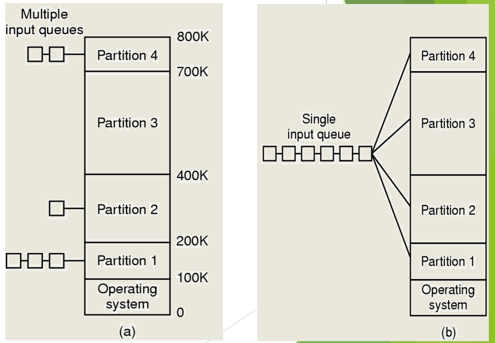
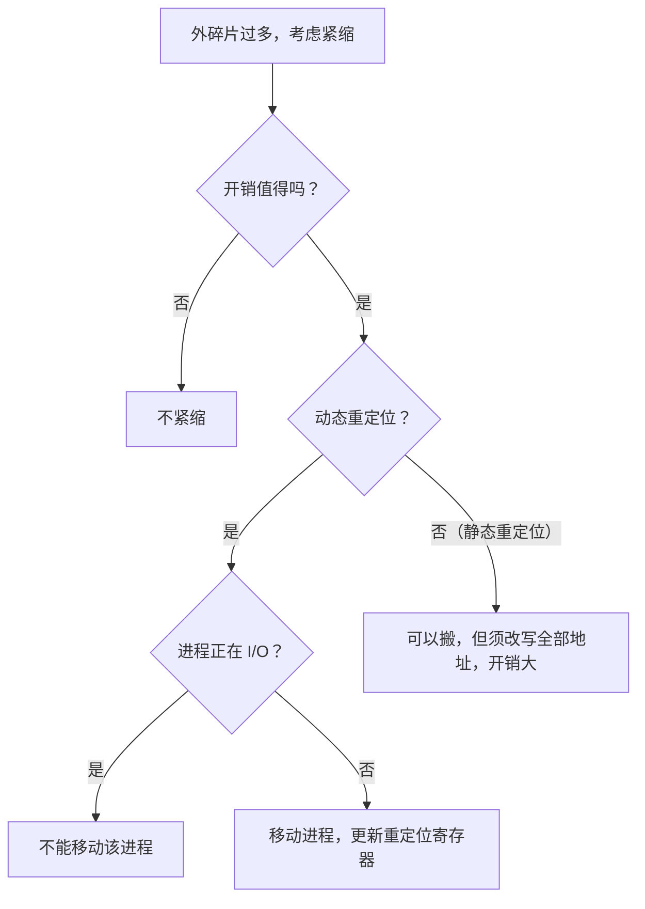

# 06 连续分配方案

[本讲目录](../index.md) · [课程目录](../../index.md) · [上一节：05 伙伴系统与 SLAB](05-segregated-fit-buddy-system-and-slab.md) · [下一节：07 页式与段式管理](07-paging-segmentation-and-segmented-paging.md)

> [!abstract] 本节要点
> - 六种基本方案是单一连续区、固定分区、可变分区、页式、段式、段页式；它们的共同前提是**加载单位为整个进程**，进程必须整个在内存中。
> - 单一连续区一次只有一个用户进程，简单但利用率低；固定分区预先切好大小固定的分区，每区只装一个进程，多队列排队会使小分区拥挤、大分区闲置，单队列可以缓解。
> - 可变分区按需切出分区，剩余部分成为新空闲区；反复分配回收会留下许多难以利用的小空闲区，即**外碎片**（“洞”）。
> - 紧缩把进程搬到一起、把小空闲区合成大空闲区，但要考虑**开销**是否值得、**移动时机**是否允许；动态重定位才便于搬，正在 I/O 的进程不能搬。

## 六种基本方案总览

从早期到今天，内存管理方案基本可以概括为六种：单一连续区、固定分区、可变分区、页式、段式、段页式。[^s2p37] 它们的差别在于用户程序的地址空间怎样划分、物理内存怎样划分、以什么为单位分配：[^s2p38]

| 方案 | 地址空间划分 | 物理内存划分 | 分配单位 | 是否要求连续 |
| --- | --- | --- | --- | --- |
| 单一连续区 | 不划分 | 用户区独占 | 整个用户区 | 连续 |
| 固定分区 | 不划分 | 预先切成大小固定的分区 | 一个分区 | 连续 |
| 可变分区 | 不划分 | 按进程需求动态切分 | 恰好所需大小的分区 | 连续 |
| 页式 | 等长的页 | 等长的页框 | 页 | 页内连续，页间可不连续 |
| 段式 | 按逻辑关系分段 | 不等长的物理段（可变分区） | 段 | 段内连续，段间可不连续 |
| 段页式 | 先分段，段内分页 | 页框 | 页 | 页间可不连续 |

后三种方案见[页式与段式管理](07-paging-segmentation-and-segmented-paging.md)。

> [!tip] 课堂强调
> 汇总表中最重要的是顶部的标注“加载单位：进程”：这六种方案都以整个进程为单位，要求整个进程都在内存中。今天的进程可以“大卸八块”，一部分在内存、一部分不在，那是下一讲虚存的内容。[^s4b7]

## 单一连续区

**单一连续区**（single contiguous allocation）指一段时间内只有一个用户进程在内存中：用户程序独占用户区，并且总是被加载到同一个内存地址上。[^s2p38]

操作系统与用户程序的相对位置有三种常见安排：操作系统在 RAM 低址、用户程序在其上；操作系统在 RAM 高址（如放在 ROM 中）、用户程序在下；或操作系统在 RAM 低址、ROM 中的设备驱动程序在高址、用户程序夹在中间。[^s2p39] 这种方案非常好管理，但同一时刻只能运行一个程序，内存利用率低。[^s4b7]

## 固定分区

为了让多个进程同时驻留，最直接的办法是预先把内存切好。**固定分区**（fixed partitioning）把可分配的内存空间分割成若干连续区域，每个区域称为**分区**；各分区大小可以相同也可以不同，但大小固定不变，每个分区装一个且只能装一个进程。[^s2p40]

进程按大小排队等待分区。例如操作系统占 0–100K，Partition 1–4 分别为 100K–200K（100K）、200K–400K（200K）、400K–700K（300K）、700K–800K（100K）。两种排队方式：[^s2p40]

1. **多队列**（multiple input queues）：每个分区一个队列，进程排在能装下自己的最小分区的队列里。问题是，如果不到 100K 的小进程很多，它们都挤在小分区的队列里，而 300K 的 Partition 3 没人排、空着不用，很不合理。[^s4b7]
2. **单队列**（single input queue）：所有进程排一个队，哪个分区空了又装得下，就把它分过去，就像银行办事“叫号”。[^s4b7]

图：内存被分为操作系统区与 Partition 1–4（边界 100K、200K、400K、700K、800K），(a) 每个分区各有一个输入队列，(b) 所有作业共用一个输入队列并分派到各分区。

> [!note] 补充解释
> 固定分区中，进程小于分区时，分区内剩余的空间别人也用不了，这属于内碎片（概念见[空闲内存管理与分配](04-free-physical-memory-management-and-allocation.md)），这是分区大小固定的直接结果。

固定分区也是“昙花一现”的方案，只在某些特定场景使用；更重要的是可变分区，它至今仍可用于一些小型系统。[^s4b7]

## 可变分区与外碎片

**可变分区**（variable partitioning）根据进程的需求，从空闲空间中切出一个分区分配给该进程，剩余部分成为新的空闲区。[^s2p41] 这与[空闲内存管理与分配](04-free-physical-memory-management-and-allocation.md)中的切分—回收过程完全一致：分区表、四种适配算法和回收合并都直接适用。

> [!info] 可视化资源
> - [OSTEP 第 16 章 分段（PDF）](https://pages.cs.wisc.edu/~remzi/OSTEP/vm-segmentation.pdf)：看图 16.6 未紧缩与紧缩后的物理内存对比，直观理解外碎片与“搬家”。

刚开始进程挨个放，利用率很好；经过一段时间的分配、回收后，进程之间会夹着一些较小的空闲区，大小不足以放下新进程，又很难利用。这种位于已分配区**之外**、进程与进程之间的小空闲区就是**外碎片**（external fragmentation），也叫“洞”（hole），它导致内存利用率下降。[^s2p41]

> [!example] 例：外碎片是怎样产生的
> 内存共 64M，操作系统占 8M。
>
> 1. P1（20M）、P2（14M）、P3（18M）依次装入，剩余 4M 空闲。
> 2. P2 换出，P4（8M）装入它腾出的 14M，剩下 6M 洞。
> 3. P1 换出，P2（14M）再装入 P1 腾出的 20M，又剩下 6M 洞。
> 4. 最终布局：OS 8M、P2 14M、空 6M、P4 8M、空 6M、P3 18M、空 4M。
>
> 空闲总量为 $6+6+4=16$M，但最大的连续空闲区只有 6M，一个 10M 的进程仍然装不下。

> [!warning] 易错点
> 内碎片在**已分配**区域内部（分出去的比实际需要多），外碎片在已分配区域**之外**（空闲块太小、太散）。可变分区按需切分，几乎没有内碎片，主要问题是外碎片；页式恰好相反。

## 紧缩技术（Memory Compaction）

外碎片单个太小，合起来却可能很可观。**紧缩技术**（memory compaction）在内存中移动程序，把所有小的空闲区合并成较大的空闲区，又称压缩技术、紧致技术、搬家技术，“搬家”一词最形象。[^s2p42]

紧缩时要考虑两个问题：[^s2p42]

1. **系统开销**：搬家要花时间，也可能需要额外空间。解决问题之前先看代价，代价小才值得做；代价太大，宁可不解决这个问题。[^s4b7]
2. **移动时机**：搬家意味着进程的起始地址改变，要考虑此刻是否每个进程都能移动。

关于移动时机，有两层判断：[^s4b7]

- **重定位方式**：采用[动态重定位](02-address-binding-and-relocation.md)时，地址在运行时才转换，搬家后只需修改重定位寄存器；采用静态重定位时，每次搬家都要把程序中的地址全部改一遍，可以做但开销大。
- **是否正在 I/O**：即使采用动态重定位，**正在进行 I/O 的进程也不能移动**。

**为什么正在 I/O 的进程不能动**：以进程 A 调用 `read` 为例。A 经系统调用进入内核后被阻塞，读盘工作不由 CPU 亲自完成，而是交给磁盘控制器或 DMA。内核只告诉 DMA 很简单的信息：从磁盘某处取多少字节，送到内存某个地址。DMA 随后占用总线，机械地把数据逐个传到那个物理地址，直到计数减到零。如果此时把 A 搬到别处，DMA 仍会把数据写到原地址，A 就找不到自己的数据，原地址上的其他内容还会被覆盖。[^s4b7]

这就像点了外卖送到教室，骑手已经在路上，你却临时去了机场，不能再要求他改送机场。后面讲交换时还会遇到同样的约束（见[覆盖与交换技术](08-memory-expansion-overlaying-and-swapping.md)）。

> [!question]- 自测：内存中有空闲区 6M、6M、4M，现在来了一个 12M 的进程。用首次适配能分配吗？紧缩后呢？
> 首次适配不能分配：没有任何单个空闲区达到 12M。紧缩后三块合并为 16M 的连续空闲区，就可以分配。前提是紧缩开销可以接受，且被移动的进程都采用动态重定位、都没有在进行 I/O。

> [!question]- 自测：系统采用动态重定位，进程 B 刚发出磁盘读请求并被阻塞。此时做紧缩，能否把 B 搬走？
> 不能。B 的读请求已交给 DMA，DMA 会把数据写入 B 原来所在的物理地址；B 被搬走后，数据会落到错误的位置。动态重定位只解决了 CPU 访存的地址转换问题，解决不了 DMA 直接使用物理地址的问题。

> [!question]- 自测：固定分区为 100K、200K、300K、100K，用多队列方式，此时来了 5 个 80K 的进程，会出现什么现象？改用单队列呢？
> 多队列下 5 个进程都排在 100K 分区的队列里，只有两个 100K 分区能用，另外 3 个进程要等，而 200K、300K 分区空着。单队列下，哪个分区空闲且装得下就去哪个，4 个进程能立即装入。

> [!info]- 来源
> - slides05.pdf：PDF p.37–42
> - L09.docx：DOCX body 175–203

[^s2p37]: slides05.pdf-PDF p.37
[^s2p38]: slides05.pdf-PDF p.38
[^s4b7]: L09.docx-DOCX body 175-203
[^s2p39]: slides05.pdf-PDF p.39
[^s2p40]: slides05.pdf-PDF p.40
[^s2p41]: slides05.pdf-PDF p.41
[^s2p42]: slides05.pdf-PDF p.42

[本讲目录](../index.md) · [课程目录](../../index.md) · [上一节：05 伙伴系统与 SLAB](05-segregated-fit-buddy-system-and-slab.md) · [下一节：07 页式与段式管理](07-paging-segmentation-and-segmented-paging.md)
