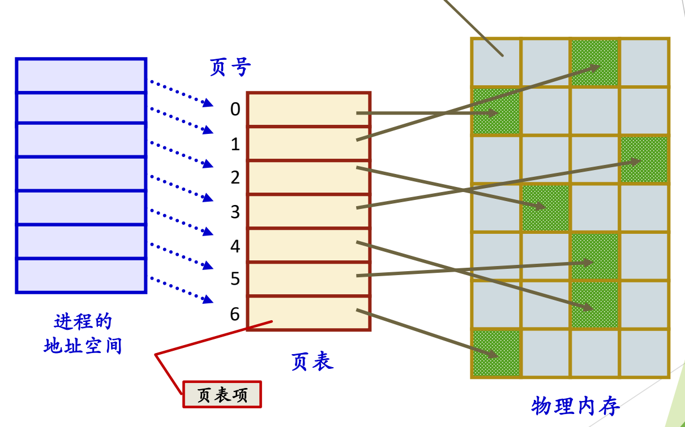
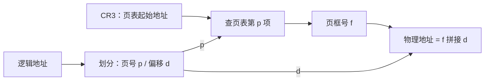
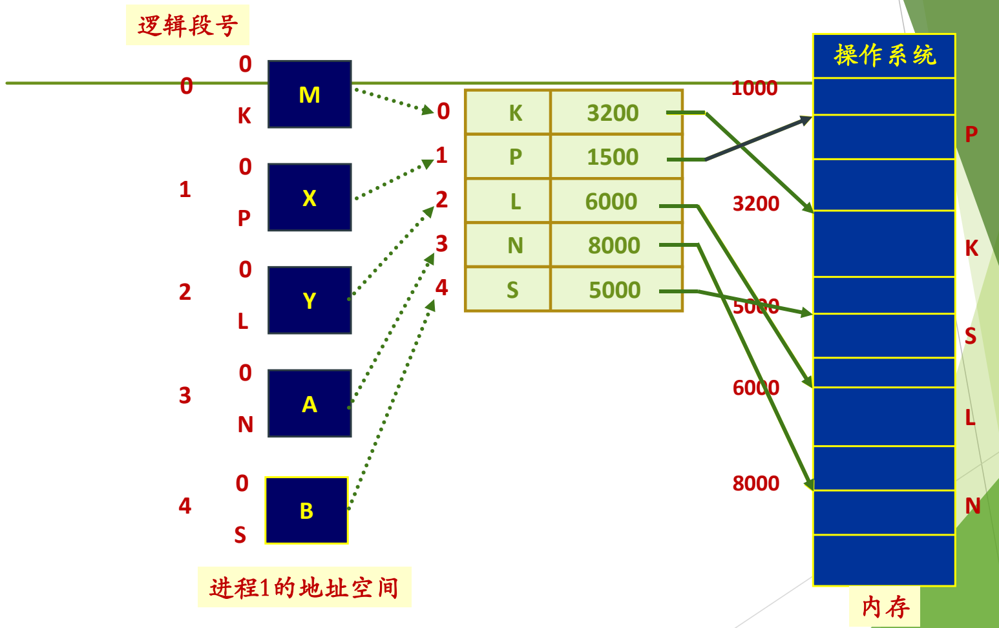

# 07 页式与段式管理

[本讲目录](../index.md) · [课程目录](../../index.md) · [上一节：06 连续分配方案](06-contiguous-allocation-schemes-and-compaction.md) · [下一节：08 覆盖与交换技术](08-memory-expansion-overlaying-and-swapping.md)

> [!abstract] 本节要点
> - 页式把逻辑地址空间分成等长的**页**（page），把物理内存分成同样大小的**页框**（page frame），逐页分配，逻辑上相邻的页在物理上不必相邻。
> - 32 位地址、4K 页面时，高 20 位是页号（0–1048575），低 12 位是页内偏移（0–4095）；按 2 的幂划分，硬件取位非常容易，对用户透明。
> - 页表由页表项组成，记录页号→页框号；每个进程一个页表，进程切换时要切换页表，其起始地址在 x86 中放在 CR3，进程下 CPU 时保存在 PCB 中。
> - MMU 把逻辑地址分成页号和偏移，用页号查页表得到页框号，再与偏移拼接成物理地址；页式会产生内碎片。
> - 段式按逻辑关系分段，段表记录段号、段起址和段长，物理内存按可变分区管理；段页式在段内再分页。x86 虽有段机制，操作系统通常只用一个段。

## 页式内存管理（Paging）

前三种方案都要求整个进程连续地放在一块内存里，这很浪费：程序中大量的错误处理代码可能永远不会执行，全部读进内存只是白占空间。如果进程可以离散地放在内存各处，就为“不必一次全部读入”打下了基础。[^s4b8]

**页式内存管理**的设计思想是：[^s2p43]

- 把用户程序的地址空间划分为大小相等的区域，称为**页**（page）。
- 把内存空间按页的大小划分为大小相等的区域，称为**页框**（page frame），也叫页帧、物理页面或内存块。
- **分配规则**：以页为单位，按进程需要的页数分配；逻辑上相邻的页，物理上不一定相邻。

> [!tip] 课堂强调
> 读英文文献时一定要分清空间：**page 一定指逻辑（虚拟）空间**中的页，**page frame 指物理内存**中的块。一看到 page frame，就知道说的是物理内存。[^s4b8]

### 逻辑地址的划分

典型的页面大小是 4K 或 4M。[^s2p43] 以 32 位逻辑地址、4K（$2^{12}$ 字节）页面为例：

$$
\text{逻辑地址} = \underbrace{\text{页号 } p}_{\text{第 31–12 位，共 20 位}} \;\Vert\; \underbrace{\text{页内偏移 } d}_{\text{第 11–0 位，共 12 位}}
$$

页号 $p$ 的取值为 $0 \sim 2^{20}-1 = 1048575$，页内偏移 $d$（页内相对地址）的取值为 $0 \sim 2^{12}-1 = 4095$。[^s2p43] 一般地，若页面大小为 $2^k$ 字节，则对逻辑地址 $A$ 有

$$
p = \left\lfloor \frac{A}{2^k} \right\rfloor, \qquad d = A \bmod 2^k
$$

由于页面大小是 2 的整数次幂，这两个运算在硬件上就是“取高位”和“取低位”，不需要做真正的除法。这种划分由系统（实际上是硬件）自动完成，对用户透明。在虚存中，硬件必须介入地址转换。[^s4b8]

## 页表与地址转换

逻辑上连续的页在物理内存中分散存放，执行到页的末尾、跳到下一页时，下一页并不在相邻的页框中，所以必须把每一页放在哪个页框记录下来。这个记录就是**页表**（page table）。[^s4b8]

> [!info] 可视化资源
> - [OSTEP 第 18 章 分页：介绍（PDF）](https://pages.cs.wisc.edu/~remzi/OSTEP/vm-paging.pdf)：看图 18.3 虚拟页号/偏移拆分与页框号拼接的转换过程，以及图 18.5 x86 页表项。

图：进程地址空间按页编号 0–6，每页对应页表中的一个页表项，页表项指向物理内存中不连续的页框（绿色格子），看相邻页号如何映射到分散的页框。

页表的要点：[^s2p46]

- 页表由**页表项**（page table entry, PTE）组成，页表项记录逻辑页号与页框号的对应关系，这是它最主要的作用（页表项的其他字段在虚存中展开）。
- **每个进程一个页表**，页表存放在内存中。

**页表起始地址保存在何处？** 硬件有一个专门的寄存器指向当前页表的起始地址，x86 中是 **CR3**。进程在 CPU 上运行时，页表起始地址在 CR3 中；进程下 CPU 时，它保存在该进程的 PCB 中。[^s4b8] 因此在上下文切换（A 下、B 上）中，最重要的一步就是切换页表：把 B 的页表起始地址从 B 的 PCB 装入 CR3（进程切换见 L06「04 进程切换与上下文切换」）。

物理内存的空闲管理在页式中比较简单：页框等长，用[位图](04-free-physical-memory-management-and-allocation.md)等任何方案都可以管理。[^s4b8]

**地址转换**由硬件（MMU）完成：[^s2p46]

1. CPU 取到逻辑地址，交给 MMU，自动划分为页号和页内地址；
2. 用页号查页表，得到页框号；
3. 把页框号与页内地址（页内偏移）拼接，得到物理地址。

> [!example] 例：页式地址转换
> 32 位地址，页面大小 4K。进程页表中第 3 项的页框号为 `0x12`。求逻辑地址 `0x00003A7C` 对应的物理地址。
>
> 1. 低 12 位为偏移：$d = \texttt{0xA7C}$；高 20 位为页号：$p = \texttt{0x00003} = 3$。
> 2. 查页表第 3 项，得到页框号 $f = \texttt{0x12}$。
> 3. 拼接：物理地址 $= f \times 2^{12} + d = \texttt{0x12000} + \texttt{0xA7C} = \texttt{0x12A7C}$。
>
> 偏移 `0xA7C` 原样保留，只有页号被替换成页框号。

这里假设进程的所有页都已装入内存，所以转换总能成功；页不在内存时会发生什么，是下一讲虚存的问题。[^s4b8]

**页式的碎片**：分配以页为单位，进程最后一页通常用不满，页内剩余空间就是**内碎片**。[^s2p46] 例如 10K 的进程在 4K 页面下要占 3 页（12K），浪费 2K。不同的管理方案产生不同的碎片：可变分区产生外碎片，页式产生内碎片。[^s4b8]

> [!warning] 易错点
> 页式转换中**偏移不参与查表**，页框号与偏移是“拼接”而不是“相加”页号。若把物理地址写成“页框号 + 偏移”，单位就错了：正确的是 $f \times 2^k + d$。

## 段式内存管理（Segmentation）

页式像切西瓜，不管内容，按大小切成等份；但如果蛋糕上有一朵漂亮的花，切蛋糕时会把整朵花完整地切下来，而不是按大小一刀切开。段式就按程序自身的逻辑结构划分。[^s4b8] 历史上段式的想法比页式更早。

**段式内存管理**的设计思想：[^s2p47]

- 用户程序地址空间按程序自身的逻辑关系划分为若干**程序段**，每段有一个段名，如主程序段 M、子程序段 X 和 Y、数组 A、工作区段 B，每段都从段内地址 0 开始编址。[^s2p48]
- 内存空间被动态地划分为若干长度不同的区域，称为**物理段**，每个物理段由起始地址和长度确定。
- **分配规则**：以段为单位分配，每段在内存中占一块连续空间，各段之间可以不相邻。
- 逻辑地址由**段号**和**段内地址**两部分组成。

> [!info] 可视化资源
> - [OSTEP 第 16 章 分段（PDF）](https://pages.cs.wisc.edu/~remzi/OSTEP/vm-segmentation.pdf)：看图 16.2 代码、堆、栈分别放入物理内存，以及图 16.3–16.5 段基址/界限/增长方向/保护位。

**段表**（segment table）记录段号、段首地址和段长度之间的关系；每个进程一个段表，存放在内存中。[^s2p50] 例如进程 1 有 5 个段，段表如下：[^s2p49]

| 段号 | 段 | 长度 | 段起址 |
| --- | --- | --- | --- |
| 0 | M | K | 3200 |
| 1 | X | P | 1500 |
| 2 | Y | L | 6000 |
| 3 | A | N | 8000 |
| 4 | B | S | 5000 |

图：进程 1 的五个段 M、X、Y、A、B 对应逻辑段号 0–4，段表把各段映射到内存基址（K 3200、P 1500、L 6000、N 8000、S 5000），每段的段内地址都从 0 开始。

**物理内存管理**：物理段长度不等，管理方法同[可变分区](06-contiguous-allocation-schemes-and-compaction.md)。[^s2p50]

**地址转换**（硬件完成）：CPU 取到逻辑地址，用段号查段表，得到段的起始地址，再与段内偏移相加得到物理地址。[^s2p50] 例如访问段 2 的段内地址 100，查段表得起址 6000，物理地址为 $6000 + 100 = 6100$。

> [!note] 补充解释
> 与页式的“拼接”不同，段起址是任意值，所以段式必须做**加法**；又因为各段长度不同，偏移必须先与段长比较，偏移 $\ge$ 段长时说明越界，要产生异常交给操作系统处理。段表中记录长度，正是为了做这一检查，作用与[界限寄存器](03-protection-evolution-and-address-space.md)相同。

段式要为每一段记录起址和长度，段有大有小，物理内存又要按可变分区管理，管理起来很复杂，所以段式用得很少。[^s4b8]

## 段页式与 x86 的取舍

**段页式内存管理**结合了页式和段式的优点、克服二者的缺点。[^s2p51] 设计思想：

- **用户程序划分**：对用户按段的逻辑关系划分；对系统，每一段再按页划分。
- **逻辑地址**：段号 + 段内地址，段内地址再分为页号 + 页内地址。
- **内存划分与分配**：按页式划分内存，以页为单位分配。[^s2p51]

数据结构：[^s2p52]

- **段表**：记录每一段的页表始址和页表长度。
- **页表**：记录逻辑页号与内存块号的对应关系；每一段有一个页表，所以一个程序可能有多个页表。
- **空闲区管理、分配与回收**：同页式。

> [!note] 补充解释
> 依据上述地址格式和数据结构，段页式的地址转换过程是：
> 1. 用段号查段表，得到该段页表的始址和长度（页号不小于页表长度即越界）；
> 2. 用段内地址中的页号查该段的页表，得到内存块号；
> 3. 内存块号与页内地址拼接，得到物理地址。
>
> 一次访存需要先后查两张表。

x86（Intel）硬件本来就有段机制，这是早期内存越来越大、需要分段管理时留下的设计。但操作系统觉得多段太复杂，于是采用了简单办法：每个进程只用一个段，并把这个段设计得足够大，实际依靠分页管理内存。所以段页式只需了解几个名词。[^s4b9]

> [!question]- 自测：32 位地址、页面大小 4K，逻辑地址 `0x0040F123` 的页号和偏移各是多少？若该页映射到页框 `0x2B`，物理地址是多少？
> 页号为高 20 位 `0x0040F`，偏移为低 12 位 `0x123`。物理地址为 `0x2B` 与 `0x123` 拼接，即 $\texttt{0x2B} \times 2^{12} + \texttt{0x123} = \texttt{0x2B123}$。

> [!question]- 自测：进程 A 切换到进程 B 时，页表方面要做什么？段式系统中段表起始地址可能放在哪里？
> 要把 A 的页表起始地址（当前在 CR3 中）保存进 A 的 PCB，再把 B 的页表起始地址从 B 的 PCB 装入 CR3。段表起始地址可以按同样道理推出：运行时放在专门的段表寄存器中，进程下 CPU 时保存在 PCB 中。

> [!question]- 自测：用上面的段表，访问段 1 的段内地址 300，物理地址是多少？如果段 1 的长度 $P$ 只有 200 呢？
> 段 1 的起址为 1500，物理地址为 $1500 + 300 = 1800$。若段长为 200，则偏移 $300 \ge 200$，越界，硬件产生异常，交给操作系统处理，不会形成物理地址。

> [!info]- 来源
> - slides05.pdf：PDF p.43–52
> - L09.docx：DOCX body 204–252

[^s4b8]: L09.docx-DOCX body 204-229
[^s2p43]: slides05.pdf-PDF p.43
[^s2p46]: slides05.pdf-PDF p.46
[^s2p47]: slides05.pdf-PDF p.47
[^s2p48]: slides05.pdf-PDF p.48
[^s2p50]: slides05.pdf-PDF p.50
[^s2p49]: slides05.pdf-PDF p.49
[^s2p51]: slides05.pdf-PDF p.51
[^s2p52]: slides05.pdf-PDF p.52
[^s4b9]: L09.docx-DOCX body 230-252

[本讲目录](../index.md) · [课程目录](../../index.md) · [上一节：06 连续分配方案](06-contiguous-allocation-schemes-and-compaction.md) · [下一节：08 覆盖与交换技术](08-memory-expansion-overlaying-and-swapping.md)
