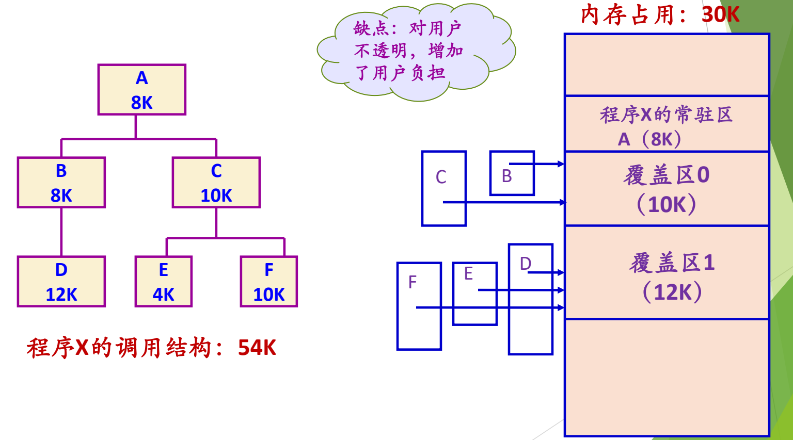
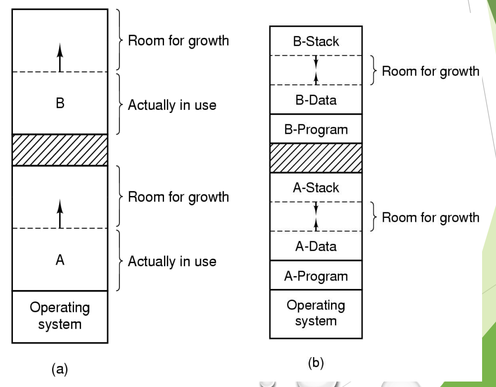
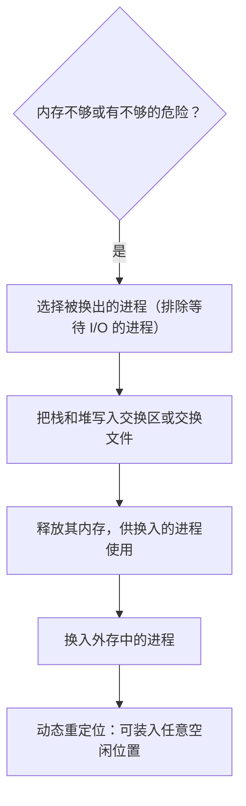

# 08 覆盖与交换技术

[本讲目录](../index.md) · [课程目录](../../index.md) · [上一节：07 页式与段式管理](07-paging-segmentation-and-segmented-paging.md)

> [!abstract] 本节要点
> - 程序大于可用内存时的对策有：内存紧凑、覆盖、交换、虚存，目标都是在较小的存储空间中运行较大的程序。
> - 覆盖技术让**不会同时执行**的模块共享同一块内存区，要求模块间调用结构清晰，由程序员声明覆盖结构、操作系统自动覆盖；对用户不透明，并且以时间换空间。
> - 交换技术在内存紧张时把某些进程暂时移到外存，再把外存中的进程换入；最早用于小型分时系统（roll in / roll out）。
> - 只有运行时创建或修改的栈和堆需要换出，存放在交换区或交换文件中；在内存不够或有不够的危险时换出，不换出等待 I/O 的进程；有动态重定位时换入不必回到原处。
> - 早期数据与栈挨着放，要预留增长空间；后来让堆和栈相向增长，形成今天的地址空间布局。

## 内存“扩充”的几条路

前面的方案都要求整个进程在内存中。程序比可用内存还大时怎么办？有四种对策，目标都是解决“在较小的存储空间中运行较大程序”的矛盾：[^s2p54]

1. **内存紧凑**：装不下只是因为碎片太多时，[紧缩](06-contiguous-allocation-schemes-and-compaction.md)就能腾出足够大的连续空间（例如可变分区）。
2. **覆盖技术**：让程序的不同部分轮流使用同一块内存。
3. **交换技术**：让进程在内存与外存之间换进换出。
4. **虚存技术**：今天的方案，它已经解决了这个问题，是下一讲的主题。[^s4b9]

## 覆盖技术（Overlaying）

**覆盖技术**要解决的问题是程序大小超过物理内存总和。它让程序的不同部分在执行过程中在内存中相互替代：按照程序自身的逻辑结构，让那些**不会同时执行**的程序段共享同一块内存区域。[^s2p55]

> [!info] 可视化资源
> - [维基百科：Overlay (programming)](https://en.wikipedia.org/wiki/Overlay_(programming))：看顶部覆盖示意图与 Example 一节的覆盖树：同深度段共享同一覆盖区。

使用覆盖有两个前提：[^s2p55]

- 程序各模块之间要有**明确的调用结构**，才能判断哪些模块不会同时执行。
- **程序员声明覆盖结构**（用脚本写出哪些模块共享哪个覆盖区），**操作系统完成自动覆盖**，即按声明在需要时把模块装入覆盖区。

覆盖技术主要用在早期的操作系统中。[^s2p55]

> [!example] 例：54K 的程序在 30K 内存中运行
> 程序 X 的调用结构：A（8K）调用 B（8K）或 C（10K）；B 调用 D（12K）；C 调用 E（4K）或 F（10K）。总大小 $8+8+10+12+4+10=54$K。[^s2p56]
>
> 1. **常驻区**：A 是根模块，始终要在内存中，单独占 8K。
> 2. **覆盖区 0**：B 和 C 是 A 的两个分支，不会同时执行，可以共享一块区域，大小取两者中较大者 $\max(8,10)=10$K。
> 3. **覆盖区 1**：D 只在 B 之下执行，E、F 只在 C 之下执行，三者两两不会同时执行，共享一块区域，大小取 $\max(12,4,10)=12$K。
> 4. **总内存占用**：$8+10+12=30$K。[^s4b9]

图：程序 X 的调用结构 A(8K) 下有 B(8K)、C(10K)，B 下有 D(12K)，C 下有 E(4K)、F(10K)，共 54K；A 常驻，B/C 共用覆盖区 0（10K），D/E/F 共用覆盖区 1（12K），内存占用仅 30K。

**覆盖技术的不足**：[^s2p57]

1. **增加编程困难**：程序员要自己划分功能模块并确定模块间的覆盖关系，增加了编程复杂度。覆盖对用户**不透明**，用户必须亲自参与；页式的划分则对用户完全透明。[^s4b9]
2. **增加执行时间**：覆盖模块要从外存装入，本质是以时间换空间。

因此覆盖技术只是“昙花一现”。[^s4b9]

> [!warning] 易错点
> 覆盖区的大小取共享该区的模块中**最大**的那个，而不是它们的和；但要判断哪些模块能共享，必须确认它们在调用树上**不可能同时处于执行中**。例中 B 和 D 有调用关系（B 调用 D 时两者同时在执行），所以不能放进同一个覆盖区。

## 交换技术（Swapping）

交换技术最早用于**小型分时系统**。当时一台机器可能有十几到几十个用户，内存只有几百 K，不可能平均分给每个用户（大部分用户不在用机时，他们的那份就空着）。做法是：时间片一到就切换，轮到哪个用户上 CPU，整个内存就归他，上一个用户的内容换到外存。这种滚进滚出叫 **roll in / roll out**。[^s4b9]

> [!info] 可视化资源
> - [OSTEP 第 21 章 超越物理内存：机制（PDF）](https://pages.cs.wisc.edu/~remzi/OSTEP/vm-beyondphys.pdf)：看图 21.1 物理内存与交换空间中各进程页的分布。

**交换技术**的设计思想：内存空间紧张时，系统把内存中某些进程暂时移到外存，把外存中某些进程换进内存，占据前者让出的区域。这实际上是进程在内存与外存之间的动态调度。[^s2p58]

实现交换要回答五个问题：[^s2p58]

### 1. 换出什么、放在哪里

进程地址空间中，代码、数据和共享库在磁盘的可执行文件或库文件中本来就有，不必写出；只有**运行时创建或修改的内容，即栈和堆**，需要写到磁盘上。[^s2p59]

被换出的内容存放在专门的区域，有两种管理方式：[^s4b9]

- **交换区**（swap space）：系统指定一块特殊的磁盘区域作为交换空间，由连续的磁道组成，操作系统用底层磁盘读写操作直接管理（管到扇区、磁道），访问效率高。[^s2p59]
- **交换文件**：向文件系统申请一个文件，把换出内容存放在这个文件里，例如 Windows 的页文件。

### 2. 何时交换

“只要不用就换出”无法实现，因为操作系统判断不了一个进程以后还会不会用。实际做法是在**内存空间不够或有不够的危险时**换出，并与调度器结合使用。[^s2p59]

“有不够的危险”就要提前做准备，就像双十一前商家备货：备多了积压库存，备少了断货、影响用户体验。内存要提前留多少余量，也面临同样的权衡。[^s4b9]

### 3. 选择换出哪个进程

这相当于后面要学的置换问题，要综合考虑进程的各种属性。无论用什么算法，**都不应换出处于等待 I/O 状态的进程**。[^s2p59] 原因与[紧缩时正在 I/O 的进程不能移动](06-contiguous-allocation-schemes-and-compaction.md)相同：DMA 会把数据传到原来的物理地址，而进程换回时不一定还在原处。[^s4b9]

### 4. 换入时是否回到原处

早期的交换（也叫“对换”）要求进程换出后再换回原来的位置。有了[动态重定位](02-address-binding-and-relocation.md)，进程无论装到哪里都能执行，所以**换出后再换入的进程不一定回到原处**。[^s2p59]

### 5. 如何处理进程空间增长

进程运行时数据（堆）和栈会增长。图 (a) 中，进程 A、B 各自在上方预留了增长空间（Room for growth），一旦超出预留就会碰到相邻的进程。过去常说的“堆栈”是把两者挨着放，要分别给它们留空间，堆长多了就会压到栈。图 (b) 的解决办法是在每个进程内部让**栈从高地址向低地址长、数据（堆）从低地址向高地址长**，两者相向增长，共用中间的一块空闲区，任何一方都可以用到另一方没用的空间。[^s4b9]

图：(a) 为进程 A、B 在实际使用区上方各预留增长空间；(b) 每个进程的数据段向上、栈段向下增长，两者之间共用一段预留空间。

这正是今天进程地址空间布局的由来：代码、数据在低处，堆向上长，栈从高处向下长（布局细节见[地址保护与地址空间](03-protection-evolution-and-address-space.md)）。[^s4b9]

> [!note] 补充解释
> 换出的单位起初是整个进程；结合页式之后，可以只换出进程的一部分页面，这就是虚存中的页面换出。虚存以交换技术为基础，再加上页式管理。

## 重点回顾

> [!info] 依据讲义整理
> 以下按讲义的“重点小结”整理，并标出对应章节。

本讲需要掌握的内容可以归为三类：[^s2p61]

1. **基本概念**：存储体系；交换与覆盖技术；逻辑地址、物理地址、地址重定位；地址保护。分别见[内存管理的任务](01-memory-management-tasks-key-concepts.md)、[地址绑定与重定位](02-address-binding-and-relocation.md)、[地址保护与地址空间](03-protection-evolution-and-address-space.md)和本节。
2. **物理内存管理**：位示图、空闲区表/已分配区表、空闲块链表、伙伴系统；分配与回收算法；碎片问题（内碎片、外碎片）。见[空闲内存管理与分配](04-free-physical-memory-management-and-allocation.md)和[伙伴系统与 SLAB](05-segregated-fit-buddy-system-and-slab.md)。
3. **各种内存管理方案**：单一连续区、固定分区、可变分区、分页、分段、段页式，以及各方案的相关数据结构和地址转换过程。见[连续分配方案](06-contiguous-allocation-schemes-and-compaction.md)和[页式与段式管理](07-paging-segmentation-and-segmented-paging.md)。

其中“相关数据结构”和“地址转换过程”要能对每种方案说清楚：页式用页表把页号换成页框号再拼接偏移，段式用段表取段起址再加偏移（并检查段长），段页式先查段表找到页表、再查页表。

> [!question]- 自测：程序调用结构为 A（6K）调用 B（10K）和 C（7K），C 调用 D（9K）和 E（5K），B 不调用其他模块。用覆盖技术最少需要多少内存？
> A 常驻 6K；B、C 互斥，覆盖区 0 取 $\max(10,7)=10$K；D、E 只在 C 下执行且互斥，覆盖区 1 取 $\max(9,5)=9$K。共 $6+10+9=25$K，而程序总大小为 $6+10+7+9+5=37$K。

> [!question]- 自测：一个进程被换出到交换区，为什么它的代码段不需要写出？它被换回时，必须装回原来的地址吗？
> 代码段在运行中不会被修改，磁盘上的可执行文件中就有完整副本，换入时直接从文件读即可；需要写出的只有运行时创建或修改的栈和堆。如果系统采用动态重定位，换入时可以放在任意空闲位置，只需更新重定位信息；只有静态重定位的系统才要求回到原处。

> [!question]- 自测：内存紧张需要换出一个进程。P1 处于等待磁盘 I/O 状态，P2 处于就绪状态，两者大小相同。应换出哪个，为什么？
> 应换出 P2。P1 的磁盘读请求已交给 DMA，DMA 会把数据写入 P1 原来的物理地址；P1 被换出后，这块内存可能已分给别的进程，数据会写错地方，而 P1 换回时也不一定在原处。所以不应换出处于等待 I/O 状态的进程。

> [!info]- 来源
> - slides05.pdf：PDF p.53–61
> - L09.docx：DOCX body 230–252

[^s2p54]: slides05.pdf-PDF p.54
[^s4b9]: L09.docx-DOCX body 230-252
[^s2p55]: slides05.pdf-PDF p.55
[^s2p56]: slides05.pdf-PDF p.56
[^s2p57]: slides05.pdf-PDF p.57
[^s2p58]: slides05.pdf-PDF p.58
[^s2p59]: slides05.pdf-PDF p.59
[^s2p61]: slides05.pdf-PDF p.61

[本讲目录](../index.md) · [课程目录](../../index.md) · [上一节：07 页式与段式管理](07-paging-segmentation-and-segmented-paging.md)
