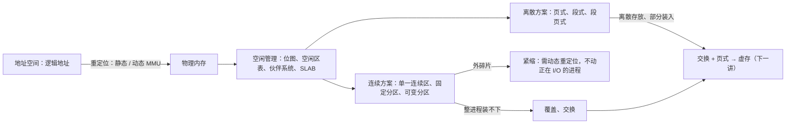

# L09 内存管理基础

[课程目录](../index.md)

进程要运行就必须有内存，本讲回答“操作系统怎样把物理内存交给多个进程使用”：先建立地址空间这一抽象，弄清逻辑地址何时、由谁转换为物理地址，以及多道程序带来的越界保护与离散化需求；再看物理内存的空闲管理、适配算法、伙伴系统与 SLAB；然后比较从单一连续区到段页式的六种方案，最后用覆盖与交换回答“大程序如何在小内存上运行”。阅读前应熟悉 L04「06 进程地址空间」中的地址空间布局与 L06「04 进程切换与上下文切换」，本讲是下一讲虚存的基础。

## 章节导航

- [01 内存管理的任务](chapters/01-memory-management-tasks-key-concepts.md)：地址空间是内存的抽象，逻辑地址重定位为物理地址
- [02 地址绑定与重定位](chapters/02-address-binding-and-relocation.md)：四个绑定时机，静态与动态重定位及 MMU
- [03 地址保护与地址空间](chapters/03-protection-evolution-and-address-space.md)：基址/界限保护、连续到离散的演化与地址空间
- [04 空闲内存管理与分配](chapters/04-free-physical-memory-management-and-allocation.md)：位图与空闲区表、四种适配算法、碎片与回收
- [05 伙伴系统与 SLAB](chapters/05-segregated-fit-buddy-system-and-slab.md)：伙伴系统按 2 的幂拆分合并，SLAB 系列管小对象
- [06 连续分配方案](chapters/06-contiguous-allocation-schemes-and-compaction.md)：单一连续区、固定与可变分区，外碎片与紧缩
- [07 页式与段式管理](chapters/07-paging-segmentation-and-segmented-paging.md)：页表映射页框并拼接偏移，段表加段起址，段页式
- [08 覆盖与交换技术](chapters/08-memory-expansion-overlaying-and-swapping.md)：覆盖共享互斥模块，交换在内外存间换进换出

## 本讲小结

本讲的主线是“逻辑地址如何落到物理内存”：重定位方式决定程序能否移动，分配单位决定产生哪种碎片，而“整个进程必须在内存”这一前提最终由交换和页式打破，演化为虚存。

| 方案 | 分配单位 | 地址转换 | 主要碎片 |
| --- | --- | --- | --- |
| 单一连续区 / 固定分区 / 可变分区 | 整个进程（一个分区） | 基址 + 逻辑地址，并用界限检查 | 固定分区内碎片，可变分区外碎片 |
| 页式 | 页 | 页号查页表得页框号 $f$，物理地址 $= f \times 2^k + d$ | 内碎片 |
| 段式 | 段 | 段号查段表得段起址，加段内偏移（偏移须小于段长） | 外碎片 |
| 段页式 | 页 | 段表 → 该段页表 → 页框号，再拼接页内偏移 | 内碎片 |

### 核心公式

| 公式 | 含义 |
| --- | --- |
| $\text{物理地址} = \text{重定位寄存器} + \text{逻辑地址}$ | 最早的 MMU（动态重定位） |
| $\text{基址} \le \text{地址} < \text{基址} + \text{界限}$ | 越界保护的合法范围 |
| $p = \lfloor A / 2^k \rfloor,\ d = A \bmod 2^k$ | 页面大小 $2^k$ 时逻辑地址 $A$ 的页号与页内偏移 |
| $2^{U-1} < s \le 2^U$ | 伙伴系统中请求 $s$ 整块分配 $2^U$ 块的条件 |

## 不确定事项

- 课上提到“把进程分成多块、不连续存放”的中间阶段被跳过，讲义无对应页，笔记只一句带过。
- 段表起始地址保存位置（s2p50 的提问）课上未回答，第 07 节自测中按页表类推作答。
- 上相邻/下相邻按 s2p26 图中低地址在上的画法解释，讲义未给出明确定义。

> [!info]- 来源
> - slides05.pdf：PDF p.1–61
> - L09.docx：DOCX body 1–252
